# UD01. Sistemas de Almacenamiento de la Información y SGBD

## 1. Introducción

Cualquier organización necesita conservar y recuperar la información que genera: datos de clientes, proveedores, empleados, facturas, inventarios... A lo largo de la historia de la informática, esta necesidad se ha resuelto mediante dos grandes enfoques:

1. **Sistemas basados en ficheros**, en los que cada aplicación gestiona directamente sus propios archivos de datos.
2. **Sistemas gestores de bases de datos (SGBD)**, en los que un software especializado centraliza el almacenamiento, el acceso y el control de la información, independizándola de las aplicaciones que la usan.

Esta unidad recorre la evolución de ambos enfoques, analiza la arquitectura interna de un SGBD, clasifica los distintos tipos de bases de datos según el modelo de datos y según la ubicación de la información, estudia las técnicas de fragmentación de datos, repasa el marco legal de protección de datos y cierra con una introducción a los conceptos de Big Data e inteligencia de negocio.

El recorrido de la unidad sigue el orden de la especificación curricular:

| Contenido | Título | RA/CE |
|---|---|---|
| UD01-C01 | Sistemas de almacenamiento basados en ficheros | RA1.a |
| UD01-C02 | Concepto y usos de las bases de datos | RA1.a |
| UD01-C03 | Tipos de bases de datos según el modelo de datos | RA1.b |
| UD01-C04 | Tipos de bases de datos según la ubicación de la información | RA1.c |
| UD01-C05 | Sistemas gestores de bases de datos. Funciones y componentes | RA1.d, RA1.e |
| UD01-C06 | Clasificación de los sistemas gestores de bases de datos | RA1.f |
| UD01-C07 | Bases de datos centralizadas y distribuidas | RA1.c, RA1.g |
| UD01-C08 | Técnicas de fragmentación de la información | RA1.h |
| UD01-C09 | Legislación sobre protección de datos | RA1.i |
| UD01-C10 | Big Data e inteligencia de negocios | RA1.j |

---

## 2. UD01-C01. Sistemas de almacenamiento basados en ficheros

<!-- content: UD01-C01 -->
<!-- origen: CB1.01 | RA1.a -->

### 2.1. El concepto de fichero

Un **fichero** (o archivo) es una colección de **registros** de igual estructura, almacenada en un dispositivo de memoria secundaria, identificada por un **nombre** y, habitualmente, una **extensión** que indica su naturaleza. Cada fichero se compone de:

- **Registro**: unidad lógica compuesta por un conjunto de campos relacionados que describen una entidad concreta (p. ej. un cliente).
- **Campo**: unidad mínima de información con un nombre, un tipo de dato y una longitud (p. ej. `NIF`, alfanumérico, 10 caracteres).
- **Campo clave**: campo (o conjunto de campos) que identifica de forma unívoca cada registro del fichero.

**Ejemplo de estructura de registro** (fichero `CLIENTES`):

| Campo | Nombre | Tipo de dato | Longitud |
|---|---|---|---|
| 1 | NIF (clave) | Alfanumérico | 10 |
| 2 | APELLIDOS | Alfanumérico | 20 |
| 3 | NOMBRE | Alfanumérico | 15 |
| 4 | NACIMIENTO | Fecha | 8 |

Un sistema gestor de ficheros debe permitir, sobre cada registro individual, las operaciones básicas: **añadir, suprimir, actualizar y consultar**.

### 2.2. Métodos de organización de ficheros

La **organización de un fichero** determina cómo se almacenan físicamente los registros en el soporte y, en consecuencia, qué métodos de acceso son posibles. Las tres organizaciones clásicas son: **secuencial**, **indexada** y **de acceso directo (hash)**.

#### 2.2.1. Organización secuencial

Los registros se almacenan **uno a continuación de otro**, generalmente ordenados por el valor del campo clave. El acceso a un registro concreto exige, en el peor caso, recorrer todos los registros anteriores.

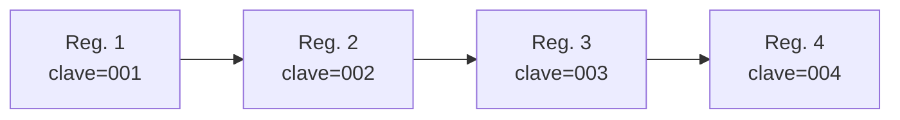

- **Ventajas**: estructura simple; eficiente para procesos de lote que recorren todos los registros (p. ej. generar un listado completo o facturación masiva).
- **Inconvenientes**: el acceso directo a un registro concreto es muy lento (acceso secuencial obligatorio); insertar un nuevo registro en su posición ordenada implica, en general, reescribir el fichero.

#### 2.2.2. Organización indexada (secuencial indexada)

Combina el almacenamiento secuencial de los registros con una **estructura de índice** adicional que asocia cada valor de clave con la posición física del registro correspondiente. El índice permite localizar un registro sin recorrer todo el fichero.

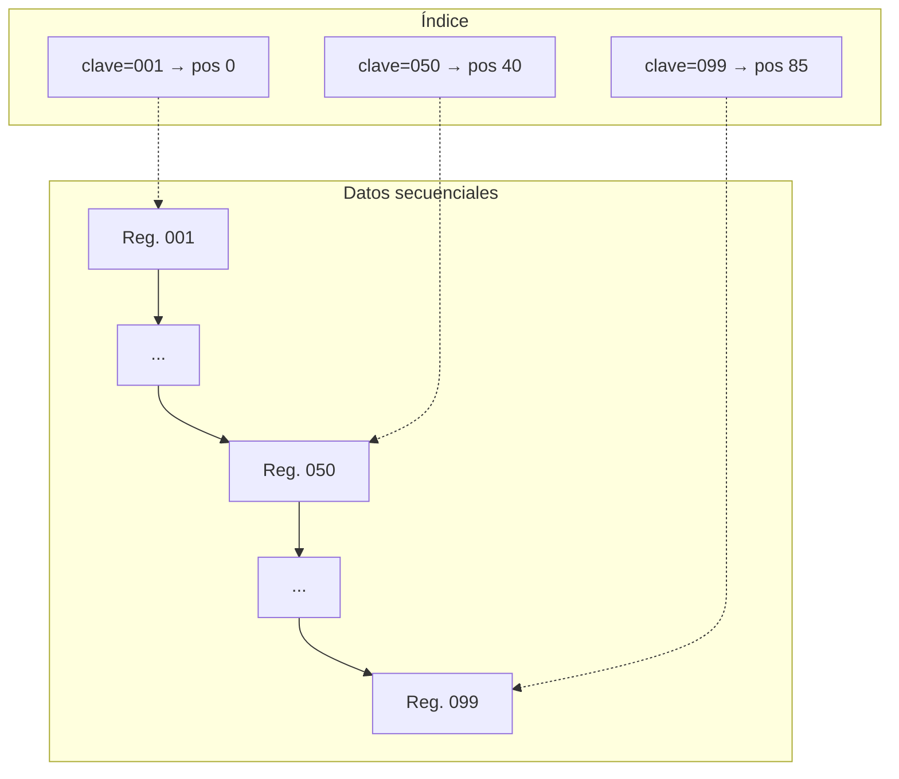

- **Ventajas**: permite tanto acceso secuencial (recorriendo los datos en orden) como acceso directo razonablemente rápido (a través del índice).
- **Inconvenientes**: el índice ocupa espacio adicional y debe mantenerse sincronizado; las inserciones pueden requerir reorganizar índice y/o zonas de desbordamiento.

#### 2.2.3. Organización de acceso directo o calculado (hash)

La posición física de un registro se obtiene aplicando una **función hash** al valor del campo clave: `posición = h(clave)`. No existe un orden secuencial entre los registros; el acceso a cualquier registro, conocida su clave, se realiza en tiempo prácticamente constante.

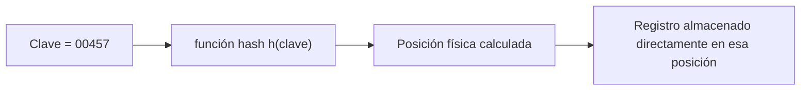

**Problema de las colisiones**: dos claves distintas pueden generar la misma posición calculada (`h(clave1) = h(clave2)`). Cuando esto ocurre, es necesario aplicar una técnica de **resolución de colisiones**, entre las que destacan:

- **Encadenamiento (listas de desbordamiento)**: cada posición almacena, además del registro, un puntero a una lista de registros adicionales que colisionaron en esa misma posición.
- **Direccionamiento abierto / recálculo**: si la posición calculada está ocupada, se busca la siguiente posición libre siguiendo una regla fija (p. ej. la siguiente posición disponible, o aplicando una segunda función hash).
- **Zona de desbordamiento (overflow area)**: se reserva una zona separada del fichero para alojar los registros que colisionan, enlazados mediante punteros desde la zona principal.

- **Ventajas**: acceso directo muy rápido a un registro conocido su clave, independiente del volumen del fichero.
- **Inconvenientes**: no permite recorrer los registros en orden de clave de forma natural; el diseño de la función hash y la gestión de colisiones es crítico para el rendimiento; el espacio puede desaprovecharse si la función hash no distribuye bien las claves.

### 2.3. Comparativa de organizaciones de ficheros

<!-- content: UD01-C01 -->

| Organización | Acceso secuencial | Acceso directo | Inserción | Caso de uso típico |
|---|---|---|---|---|
| Secuencial | Muy eficiente | Muy ineficiente (recorrido completo) | Costosa (reescritura/reordenación) | Procesos por lotes sobre todos los registros |
| Indexada (secuencial indexada) | Eficiente | Eficiente (vía índice) | Moderada (mantenimiento del índice) | Consultas puntuales y procesos de lote combinados |
| Directa / hash | No natural | Muy eficiente (cálculo directo) | Eficiente salvo colisiones | Acceso aleatorio frecuente por clave conocida |

### 2.4. Limitaciones del enfoque basado en ficheros

Cuando varias aplicaciones gestionan sus propios ficheros de forma independiente surgen problemas estructurales que, históricamente, motivaron la aparición de los SGBD:

1. **Redundancia e inconsistencia de datos**: un mismo dato (p. ej. la dirección de un cliente) puede aparecer duplicado en varios ficheros gestionados por aplicaciones distintas. Si se actualiza en un fichero y no en los demás, los datos dejan de ser coherentes entre sí.
2. **Dificultad de acceso a la información**: si una consulta no estaba prevista en el diseño original de los programas, no existe forma directa de obtenerla sin programación adicional.
3. **Aislamiento de los datos**: los datos están dispersos en ficheros con formatos distintos, a veces generados con lenguajes de programación incompatibles entre sí.
4. **Anomalías de acceso concurrente**: si dos procesos modifican el mismo dato casi simultáneamente sin ningún mecanismo de control, el resultado final puede ser incorrecto (p. ej. dos retiradas simultáneas de una cuenta bancaria que no se descuentan correctamente si no hay sincronización).
5. **Problemas de seguridad**: es difícil restringir el acceso de cada usuario únicamente a la parte de la información que le corresponde.
6. **Problemas de integridad**: las restricciones de consistencia (p. ej. que un saldo no sea negativo) quedan codificadas de forma dispersa dentro de cada programa de aplicación, lo que dificulta su mantenimiento.
7. **Dependencia física-lógica**: la estructura física de los ficheros (campos, longitudes, tipos) está embebida en el código de los programas. Cualquier cambio en esa estructura obliga a modificar y volver a probar todos los programas que la usan.

### 2.5. Errores frecuentes

- Confundir "fichero" con "archivo de texto plano": un fichero de datos puede tener cualquier organización interna (secuencial, indexada o hash), no solo texto plano.
- Pensar que la organización indexada sustituye completamente a la secuencial: en realidad la organización secuencial indexada **combina** ambos mecanismos.
- Creer que el acceso hash siempre es más rápido que el indexado en cualquier circunstancia: su eficiencia depende de la calidad de la función hash y de la tasa de colisiones.

---

## 3. UD01-C02. Concepto y usos de las bases de datos

<!-- content: UD01-C02 -->
<!-- origen: CB1.02, CB1.02.01, CB1.02.02 | RA1.a -->

### 3.1. Definición formal de base de datos

> **Base de datos**: colección de datos interrelacionados, almacenados en conjuntos sin redundancias perjudiciales o innecesarias, cuya finalidad es servir a una o más aplicaciones de la mejor manera posible.

Un **Sistema de Base de Datos** es el sistema mecanizado por ordenador para manejar esa información, compuesto por cuatro elementos:

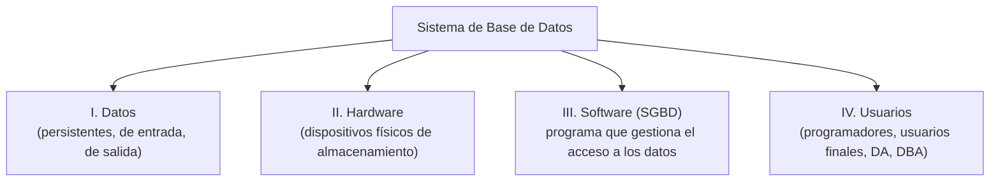

**Clasificación de los datos del sistema**:

- **Datos persistentes o fijos**: permanecen en la base de datos de manera indefinida.
- **Datos de entrada**: se introducen por primera vez en la base de datos (teclado, importación desde fichero, etc.).
- **Datos de salida**: se obtienen de la base de datos hacia un destino externo (pantalla, impresora, fichero), pudiendo ser datos directos o resultados estadísticos.

**Clasificación de los usuarios**:

| Tipo de usuario | Función |
|---|---|
| Programadores de aplicaciones | Desarrollan y mantienen las aplicaciones que usan la base de datos |
| Usuarios finales | Consultan o modifican datos, de forma directa (lenguaje de consulta) o a través de programas |
| Administrador de datos (DA) | Decide qué datos deben almacenarse; no requiere perfil técnico, suele ocupar un cargo directivo |
| Administrador de la base de datos (DBA) | Decide cómo almacenar los datos definidos por el DA; controla y administra técnicamente la base de datos |

### 3.2. Ventajas del enfoque de bases de datos frente a ficheros

1. **Independencia de los datos respecto de las aplicaciones**: el usuario trabaja con una visión abstracta de los datos sin conocer su implementación física (ficheros, índices, etc.).
2. **Disminución de la redundancia de los datos**: cada dato tiende a figurar una única vez, reduciendo el riesgo de incoherencia entre copias. (La redundancia controlada puede mantenerse por motivos de fiabilidad, disponibilidad o coste de comunicaciones.)
3. **Mayor integridad de datos**: el SGBD incorpora reglas de integridad que impiden que un programa realice una operación que contradiga las restricciones definidas sobre los datos.
4. **Mayor disponibilidad de datos**: permite recuperar la base de datos ante sucesos imprevistos.
5. **Compartición de datos**: varios usuarios pueden acceder simultáneamente a los datos, con mecanismos previstos para preservar su integridad.
6. **Mayor seguridad de los datos**: el SGBD permite definir autorizaciones y derechos de acceso a distintos niveles, normalmente asociados a credenciales de usuario.

### 3.3. Desventajas del enfoque de bases de datos

| Ámbito | Desventaja |
|---|---|
| Implantación | Instalación costosa en equipos y software |
| Implantación | Instalación larga y difícil |
| Implantación | Falta de rentabilidad a corto plazo |
| Usuarios | Necesidad de personal especializado en su manejo y administración |

### 3.4. ¿Cuándo usar ficheros y cuándo bases de datos?

Como criterio general: se utiliza un sistema de ficheros cuando el volumen de datos a gestionar es tan reducido que no justifica el coste de implantar un SGBD (p. ej. una sencilla aplicación de agenda con campos de texto ordenados por fecha). Cuando el volumen y la complejidad de la información crecen —o cuando varias aplicaciones deben compartir los mismos datos de forma coherente— el enfoque de bases de datos resulta más adecuado.

### 3.5. Errores frecuentes

- Confundir "base de datos" con "SGBD": la base de datos es el conjunto de datos almacenados; el SGBD es el software que los gestiona.
- Creer que eliminar la redundancia implica eliminarla siempre al 100 %: en ocasiones se mantiene redundancia controlada por motivos de disponibilidad o rendimiento.

---

## 4. UD01-C03. Tipos de bases de datos según el modelo de datos

<!-- content: UD01-C03 -->
<!-- origen: CB1.02.03 | RA1.b -->

### 4.1. Concepto de modelo de datos

Un **modelo de datos** es el conjunto de conceptos, reglas y notaciones que permiten describir la estructura lógica de los datos: qué entidades existen, qué atributos tienen y cómo se relacionan entre sí. El modelo de datos utilizado por un SGBD determina su forma de representar, consultar y manipular la información.

### 4.2. Clasificación según el modelo de datos

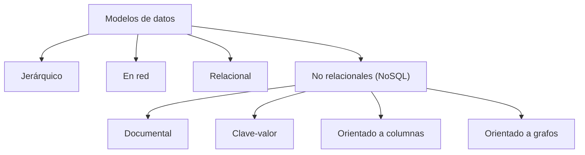

#### 4.2.1. Modelo jerárquico

Organiza los datos en una **estructura de árbol**: cada registro (nodo) tiene un único padre, salvo el nodo raíz, y puede tener varios hijos. Las relaciones son de tipo 1:N (uno a muchos) y recorren el árbol de arriba hacia abajo.

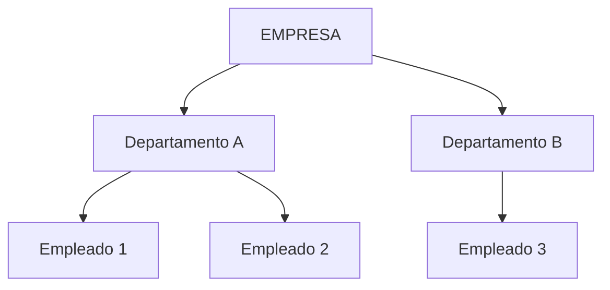

- **Ventaja**: sencillez conceptual y eficiencia cuando las relaciones reales son estrictamente jerárquicas.
- **Limitación**: no representa de forma natural relaciones muchos a muchos (un hijo con más de un padre).

#### 4.2.2. Modelo en red

Generaliza el modelo jerárquico permitiendo que un registro tenga **varios padres** (relaciones N:M mediante conjuntos de enlaces). Se representa mediante un **grafo** en lugar de un árbol estricto.

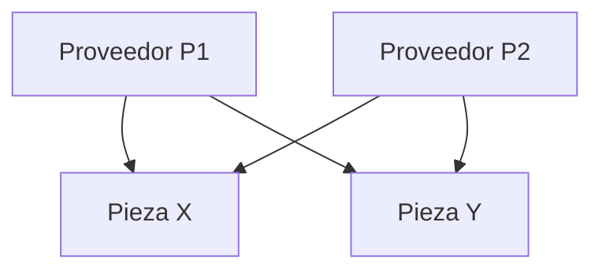

- **Ventaja**: mayor flexibilidad que el jerárquico para relaciones complejas.
- **Limitación**: la navegación por punteros entre registros hace que las consultas dependan en exceso de la estructura física, reduciendo la independencia de los datos.

#### 4.2.3. Modelo relacional

Organiza los datos en **tablas (relaciones)** compuestas por filas (tuplas) y columnas (atributos). Las relaciones entre tablas se establecen mediante valores compartidos (claves primarias y claves ajenas), no mediante punteros físicos. Es, con diferencia, el modelo más extendido en los SGBD comerciales (Oracle, SQL Server, MySQL, PostgreSQL...).

| ID_CLIENTE | NOMBRE | NIF |
|---|---|---|
| 1 | Ana Pérez | 11111111A |
| 2 | Luis Gómez | 22222222B |

| ID_PEDIDO | ID_CLIENTE | FECHA |
|---|---|---|
| 100 | 1 | 2026-01-10 |
| 101 | 2 | 2026-01-11 |

La relación entre ambas tablas se establece mediante el valor de `ID_CLIENTE`, sin necesidad de punteros físicos.

- **Ventaja**: fuerte independencia lógica/física, base matemática sólida (álgebra relacional), lenguaje declarativo (SQL).
- **Limitación**: en escenarios de gran escala con datos muy variables o no estructurados, puede resultar menos flexible que los modelos NoSQL.

#### 4.2.4. Modelos NoSQL (no relacionales)

Surgen para dar respuesta a necesidades de escalabilidad horizontal y flexibilidad de esquema que el modelo relacional, en determinados escenarios de gran volumen, no resuelve con la misma eficiencia.

| Tipo NoSQL | Unidad de almacenamiento | Ejemplo de uso |
|---|---|---|
| Documental | Documentos semiestructurados (JSON/BSON) | Catálogos de productos con atributos variables |
| Clave-valor | Pares `clave → valor` | Cachés, sesiones de usuario |
| Orientado a columnas | Columnas agrupadas por familias | Grandes volúmenes analíticos, series temporales |
| Orientado a grafos | Nodos y relaciones (aristas) | Redes sociales, sistemas de recomendación |

**Ejemplo documental** (JSON):

```json
{
  "id_cliente": 1,
  "nombre": "Ana Pérez",
  "pedidos": [
    { "id_pedido": 100, "fecha": "2026-01-10" }
  ]
}
```

### 4.3. Tabla comparativa de modelos

| Modelo | Estructura | Relaciones | Flexibilidad de esquema | Madurez / uso típico |
|---|---|---|---|---|
| Jerárquico | Árbol | 1:N estricto | Baja | Sistemas legados muy específicos |
| Red | Grafo con punteros | N:M mediante enlaces | Baja | Sistemas legados |
| Relacional | Tablas | Mediante claves | Baja/media (esquema fijo) | Gestión transaccional general |
| Documental | Documentos | Embebidas o referenciadas | Alta | Datos semiestructurados |
| Clave-valor | Pares clave-valor | Ninguna explícita | Muy alta | Caché, alta velocidad |
| Columnas | Familias de columnas | Según familia | Alta | Big data analítico |
| Grafos | Nodos/aristas | Explícitas y navegables | Alta | Relaciones complejas |

### 4.4. Errores frecuentes

- Pensar que NoSQL significa "sin SQL en ningún caso": algunos sistemas NoSQL también ofrecen lenguajes de consulta similares a SQL.
- Asumir que el modelo relacional ha sido sustituido por NoSQL: ambos conviven, cada uno adecuado a escenarios distintos.

---

## 5. UD01-C04. Tipos de bases de datos según la ubicación de la información

<!-- content: UD01-C04 -->
<!-- origen: CB1.02.04 | RA1.c -->

### 5.1. Clasificación según la ubicación

Atendiendo a dónde físicamente reside la información y cómo se accede a ella, las bases de datos se clasifican principalmente en **centralizadas** y **distribuidas**. Esta clasificación se desarrolla en detalle en el contenido UD01-C07, donde se estudian su arquitectura, ventajas, inconvenientes y los mecanismos de transacciones distribuidas.

Adicionalmente, según el **número de usuarios** que pueden acceder simultáneamente, las bases de datos se clasifican en:

| Criterio | Tipo | Descripción |
|---|---|---|
| Número de usuarios | Monousuario | Solo un usuario puede acceder a la vez |
| Número de usuarios | Multiusuario | Varios usuarios pueden acceder de forma simultánea |
| Ubicación | Centralizada | Toda la información reside en una única ubicación física |
| Ubicación | Distribuida | La información está repartida entre varias ubicaciones físicas interconectadas |

### 5.2. Relación con la arquitectura operacional

La ubicación de la información está estrechamente relacionada con la **arquitectura operacional** bajo la que se despliega el SGBD:

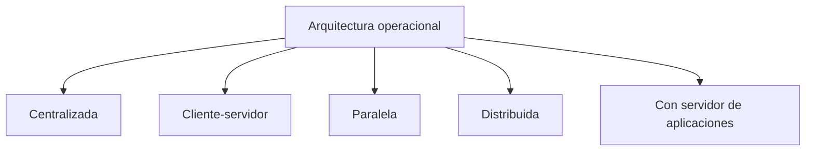

- **Centralizada**: todo el procesamiento y almacenamiento se realiza en un único equipo (o clúster lógicamente único).
- **Cliente-servidor**: los clientes envían peticiones a un servidor central que aloja el SGBD y devuelve los resultados.
- **Paralela**: el procesamiento se reparte entre varios procesadores que cooperan sobre los mismos datos, normalmente dentro de un mismo centro de datos.
- **Distribuida**: los propios datos están repartidos entre nodos físicamente separados, que pueden estar en ubicaciones geográficas distintas.
- **Con servidor de aplicaciones**: se añade una capa intermedia (middleware) entre los clientes y el servidor de base de datos, habitual en arquitecturas web de tres capas.

### 5.3. Errores frecuentes

- Confundir "cliente-servidor" con "distribuida": en cliente-servidor los datos están centralizados en un único servidor, aunque existan múltiples clientes.
- Pensar que "distribuida" implica necesariamente "replicada": la distribución puede implicar fragmentación (cada nodo con una parte distinta de los datos) sin que exista necesariamente redundancia entre nodos.

---

## 6. UD01-C05. Sistemas gestores de bases de datos. Funciones y componentes

<!-- content: UD01-C05 -->
<!-- origen: CB1.03, CB1.03.01, CB1.03.02 | RA1.d, RA1.e -->

### 6.1. Definición de SGBD

> Un **Sistema Gestor de Bases de Datos (SGBD)** —también denominado DBMS (*Database Management System*)— es una aplicación que permite a los usuarios **definir, crear y mantener** la base de datos, proporcionando **acceso controlado** a la misma. Actúa como interfaz entre el usuario (o las aplicaciones) y los datos físicamente almacenados.

### 6.2. Funciones principales de un SGBD

1. **Definición de la estructura de los datos** (esquemas, tipos, restricciones) mediante el lenguaje de definición de datos (DDL).
2. **Manipulación de los datos** (inserción, borrado, actualización y consulta) mediante el lenguaje de manipulación de datos (DML).
3. **Control de acceso y seguridad**, concediendo o revocando privilegios a los usuarios mediante el lenguaje de control de datos (DCL).
4. **Mantenimiento de la integridad** de los datos, aplicando las reglas y restricciones definidas sobre el esquema.
5. **Gestión de la concurrencia**, permitiendo el acceso simultáneo de múltiples usuarios sin que se produzcan inconsistencias.
6. **Recuperación ante fallos**, restaurando la base de datos a un estado consistente tras un error o un corte del servicio.
7. **Mantenimiento de la independencia de los datos** respecto de las aplicaciones que los usan.

### 6.3. Arquitectura de tres niveles ANSI/SPARC

La arquitectura más utilizada para organizar una base de datos distingue **tres niveles de abstracción**, según la perspectiva desde la que se observe la información:

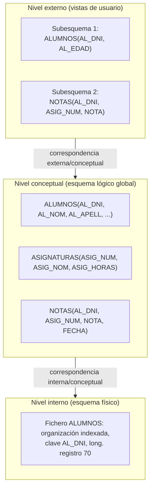

| Nivel | También llamado | Qué describe | Ejemplo |
|---|---|---|---|
| **Externo** | Nivel de usuario | Percepciones individuales (subesquemas o vistas) de distintos grupos de usuarios | Un subesquema con solo DNI y edad del alumno |
| **Conceptual** | Nivel lógico | La estructura lógica global de los datos y sus relaciones, independiente de cómo se almacenen físicamente | Entidades ALUMNOS, ASIGNATURAS, NOTAS y sus reglas de negocio |
| **Interno** | Nivel físico | Cómo se almacenan realmente los datos: organización de ficheros, tipo de acceso, índices | Fichero `ALUMNOS` con organización indexada y clave `AL_DNI` |

Un **subesquema** (nivel externo) puede combinar campos de distintos registros del esquema conceptual, omitir campos, reordenarlos o añadir campos calculados; distintos usuarios pueden compartir el mismo subesquema o trabajar con subesquemas diferentes sobre la misma base de datos.

### 6.4. Independencia de los datos

> **Independencia de datos**: capacidad de modificar el esquema de un nivel sin tener que modificar el esquema del nivel inmediatamente superior.


- **Independencia física**: el esquema conceptual (y los externos) no se ven afectados por cambios en el esquema interno (p. ej. reorganizar ficheros físicos, cambiar índices, cambiar de soporte de almacenamiento) siempre que los datos lógicamente representados no varíen.
- **Independencia lógica**: los esquemas externos y los programas de aplicación no se ven afectados por cambios en el esquema conceptual que no afecten a los datos que ellos utilizan (p. ej. añadir un nuevo atributo o una nueva entidad sin tocar los atributos ya existentes que usa una aplicación concreta).

**Ejemplo de independencia lógica**: si se amplía la longitud del campo `NOMBRE` de 30 a 50 caracteres, los programas existentes no necesitan modificarse si siguen aceptando mostrar solo los primeros 30 caracteres.

**Ejemplo de independencia física**: añadir un índice adicional sobre un campo para acelerar las búsquedas no debería requerir ningún cambio en el esquema conceptual ni en las aplicaciones.

### 6.5. Componentes internos de un SGBD

Un SGBD se organiza internamente en módulos que llevan a cabo funciones específicas:

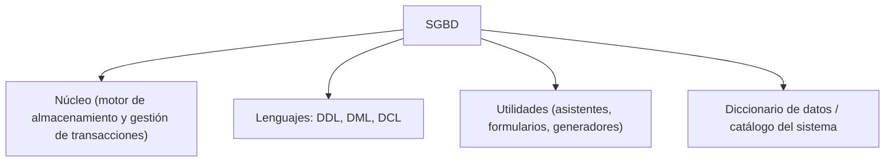

| Componente | Función |
|---|---|
| **Núcleo** (motor de almacenamiento + gestor de transacciones) | Coordina y controla el funcionamiento global del SGBD: controla la integridad y la seguridad, implementa la comunicación entre niveles, facilita la independencia de los datos y gestiona el diccionario de datos. Es transparente al usuario. |
| **Procesador de consultas** | Interpreta y optimiza las sentencias DML (p. ej. SQL) para ejecutarlas de la forma más eficiente posible sobre el motor de almacenamiento. |
| **Gestor de transacciones** | Garantiza que las transacciones se ejecuten de forma atómica, consistente, aislada y duradera (propiedades ACID), coordinando la concurrencia y la recuperación ante fallos. |
| **Lenguajes** | **DDL** (definición de datos): define el esquema conceptual y los subesquemas externos, y permite establecer parte de la seguridad. **DML** (manipulación de datos): permite añadir, eliminar, modificar y recuperar información. **DCL** (control de datos): concede o revoca permisos a los usuarios sobre los objetos de la base de datos. |
| **Utilidades** | Aplicaciones con interfaz sencilla (menús, asistentes) que facilitan tareas a usuarios y programadores: generadores de formularios, de informes, etc. |
| **Diccionario de datos / catálogo del sistema** | Almacén integrado donde se guarda toda la información referente a la descripción, gestión e implantación de la base de datos (metadatos: tablas, columnas, tipos, restricciones, permisos, etc.). |

### 6.6. Usuarios de la base de datos

Además de los perfiles ya descritos en UD01-C02 (programadores y usuarios finales), se distinguen:

| Perfil | Rol |
|---|---|
| **Administrador de la base de datos (DBA)** | Responsable del control y administración técnica de la base de datos |
| Usuarios técnicos | Diseñadores, operadores, personal de mantenimiento, analistas, programadores |
| Usuarios finales | Explotan la base de datos sin conocimiento técnico sobre los datos, pero con conocimiento del negocio (analistas de negocio, ejecutivos, etc.) |

### 6.7. Errores frecuentes

- Confundir el nivel externo con el nivel conceptual: el nivel externo son *vistas particulares*, mientras que el conceptual es el *esquema global único* de la base de datos.
- Pensar que independencia física e independencia lógica son equivalentes: afectan a niveles distintos de la arquitectura (interno/conceptual vs. conceptual/externo).
- Asumir que el diccionario de datos solo contiene nombres de tablas: en realidad incluye toda la metainformación (tipos, restricciones, índices, permisos, relaciones).

---

## 7. UD01-C06. Clasificación de los sistemas gestores de bases de datos

<!-- content: UD01-C06 -->
<!-- origen: CB1.03.03 | RA1.f -->

### 7.1. Criterios de clasificación de los SGBD

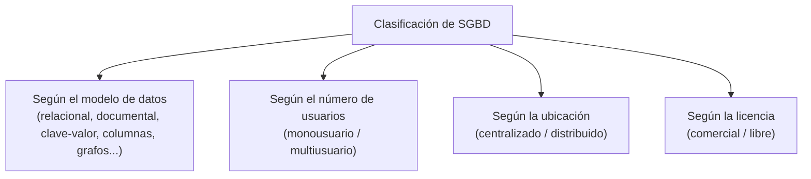

| Criterio | Categorías | Ejemplos de SGBD representativos por categoría |
|---|---|---|
| Modelo de datos | Relacional, documental, clave-valor, columnas, grafos | Ver tabla UD01-C03 |
| Número de usuarios | Monousuario, multiusuario | Un gestor de ficheros local frente a un servidor multiusuario |
| Ubicación | Centralizado, distribuido | Ver UD01-C07 |
| Licencia | Comercial (de pago), libre (código abierto) | SGBD con licencia propietaria frente a proyectos de software libre |

### 7.2. SGBD comerciales frente a SGBD libres

| Aspecto | SGBD comerciales | SGBD libres |
|---|---|---|
| Coste de licencia | Requiere pago de licencia | Gratuitos (pueden tener coste de soporte) |
| Soporte técnico | Soporte oficial del fabricante | Comunidad y/o soporte comercial opcional |
| Código fuente | Cerrado | Habitualmente abierto |
| Flexibilidad de personalización | Limitada al producto del fabricante | Mayor posibilidad de adaptación |

### 7.3. Errores frecuentes

- Confundir "libre" con "gratuito sin soporte posible": existen empresas que ofrecen soporte comercial de pago sobre SGBD libres.
- Pensar que todos los SGBD de un mismo modelo de datos ofrecen exactamente las mismas funcionalidades: cada producto puede añadir extensiones propias.

---

## 8. UD01-C07. Bases de datos centralizadas y distribuidas

<!-- content: UD01-C07 -->
<!-- origen: CB1.04 | RA1.c, RA1.g -->

### 8.1. Bases de datos centralizadas

En una **base de datos centralizada**, todos los datos y el SGBD residen en un único sistema (un servidor o un clúster lógicamente único). Todas las peticiones de acceso se dirigen a ese punto central.

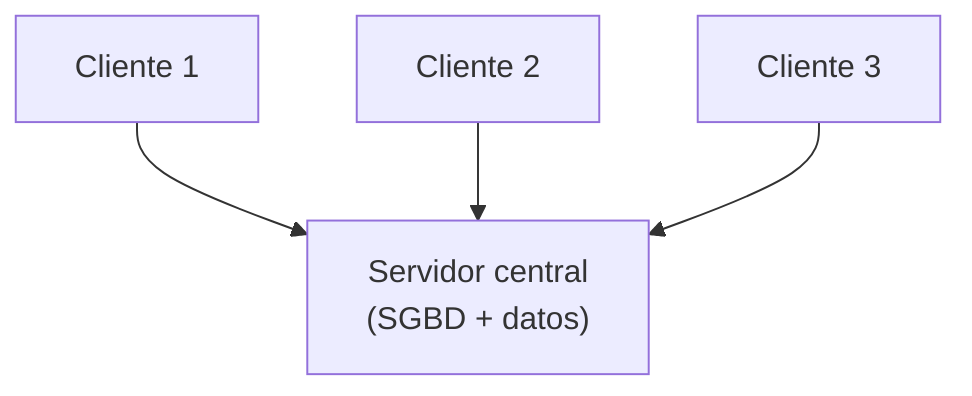

| Ventajas | Inconvenientes |
|---|---|
| Administración y seguridad más sencillas (un único punto de control) | Punto único de fallo: si el servidor cae, toda la base de datos deja de estar disponible |
| Consistencia de datos garantizada de forma directa | Puede convertirse en un cuello de botella de rendimiento al crecer el número de usuarios |
| Menor complejidad en el control de transacciones | Latencia elevada para usuarios geográficamente alejados del servidor |

### 8.2. Bases de datos distribuidas

En una **base de datos distribuida**, los datos están repartidos físicamente entre varios nodos (ubicaciones), interconectados mediante una red, pero gestionados de forma que el conjunto se comporte, de cara al usuario, como una única base de datos lógica.

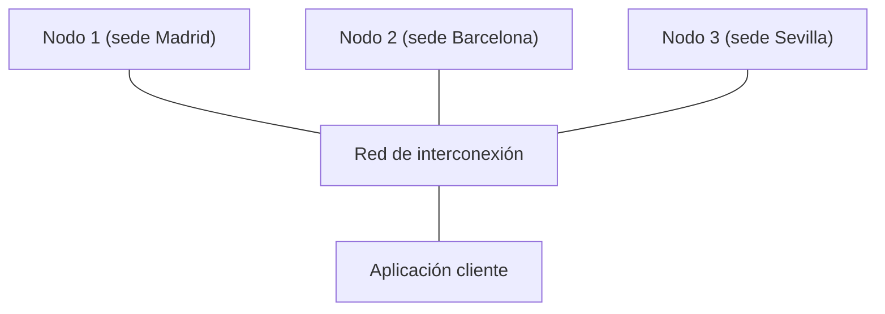

| Ventajas | Inconvenientes |
|---|---|
| Mayor disponibilidad: la caída de un nodo no tiene por qué afectar a los demás | Mayor complejidad de diseño, administración y mantenimiento |
| Escalabilidad: se puede crecer añadiendo nodos | Las transacciones que afectan a varios nodos son más complejas de coordinar |
| Los datos pueden ubicarse físicamente cerca de donde se usan, reduciendo la latencia | Mayor riesgo de inconsistencia temporal entre réplicas |
| Tolerancia a fallos mediante réplicas | Mayor coste de infraestructura de comunicaciones |

### 8.3. Transacciones distribuidas y el protocolo de Commit en Dos Fases (2PC)

Cuando una transacción afecta a datos ubicados en **varios nodos distintos**, es necesario garantizar que todos los nodos implicados confirmen (`commit`) o deshagan (`rollback`) la transacción de forma coordinada; de lo contrario, podría ocurrir que unos nodos confirmasen los cambios y otros no, dejando el sistema en un estado inconsistente.

El **protocolo de confirmación en dos fases (Two-Phase Commit, 2PC)** resuelve este problema mediante la figura de un **coordinador** y varios **nodos participantes**:

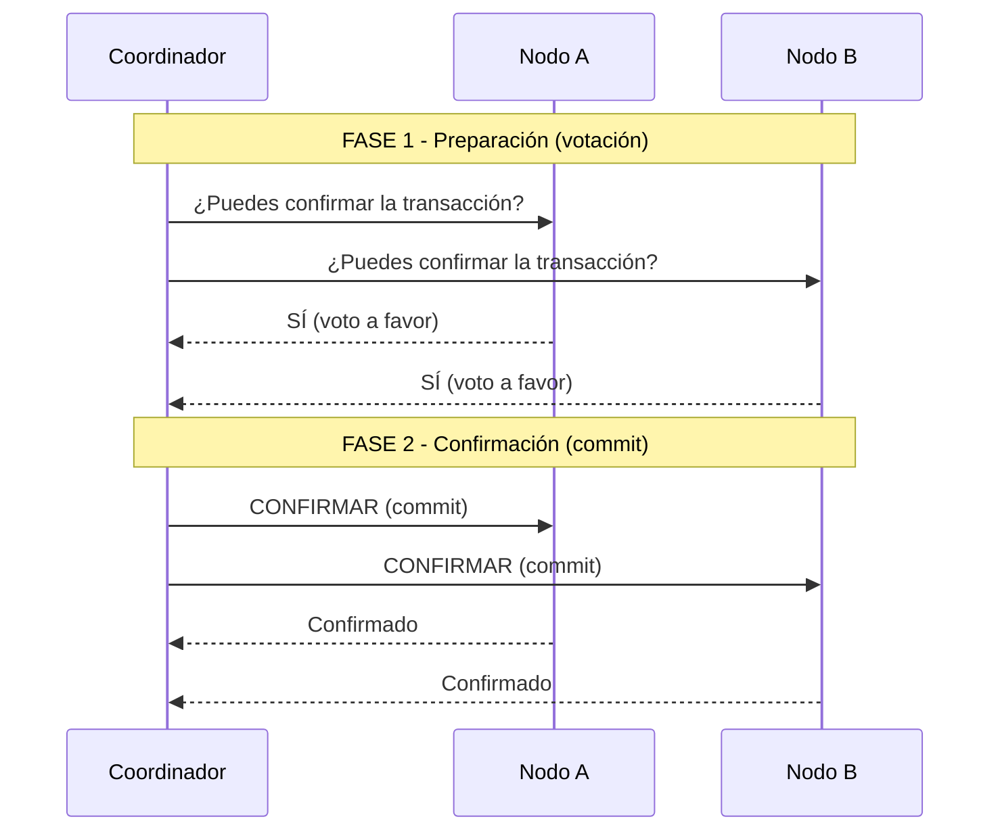

- **Fase 1 (preparación/votación)**: el coordinador pregunta a todos los nodos participantes si están en condiciones de confirmar la transacción. Cada nodo responde con un voto (`sí`/`no`) tras dejar sus cambios preparados pero sin confirmarlos definitivamente.
- **Fase 2 (confirmación o aborto)**: si **todos** los nodos votaron a favor, el coordinador envía la orden de confirmar (`commit`) a todos ellos. Si **algún** nodo vota en contra (o no responde), el coordinador envía la orden de deshacer (`rollback`) a todos los participantes.

De este modo se garantiza que la transacción se confirme en todos los nodos o en ninguno, preservando la consistencia global del sistema distribuido.

### 8.4. El teorema CAP

El **teorema CAP** (Brewer) establece que un sistema distribuido de almacenamiento de datos no puede garantizar simultáneamente, de forma permanente, más de dos de las tres propiedades siguientes:

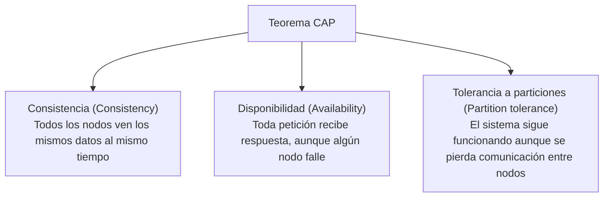

Dado que en un sistema distribuido real las particiones de red son inevitables (la tolerancia a particiones no es opcional), en la práctica el diseñador debe decidir el compromiso entre **consistencia** y **disponibilidad** cuando se produce una partición de red:

| Prioridad | Significado práctico |
|---|---|
| CP (Consistencia + Partición) | Ante una partición de red, el sistema prioriza devolver datos consistentes, aunque eso implique rechazar algunas peticiones (menor disponibilidad) |
| AP (Disponibilidad + Partición) | Ante una partición de red, el sistema prioriza seguir respondiendo a todas las peticiones, aunque los datos devueltos puedan no estar perfectamente actualizados en todos los nodos |

### 8.5. Errores frecuentes

- Pensar que el teorema CAP obliga a renunciar completamente a una de las tres propiedades en todo momento: solo se renuncia a una de ellas (C o A) **durante el tiempo en que existe una partición de red**.
- Creer que 2PC elimina por completo el riesgo de bloqueo: si el coordinador falla tras la fase de votación y antes de notificar la decisión final, algunos nodos pueden quedar bloqueados esperando la resolución.

---

## 9. UD01-C08. Técnicas de fragmentación de la información

<!-- content: UD01-C08 -->
<!-- origen: CB1.05 | RA1.h -->

### 9.1. Concepto de fragmentación

> **Fragmentación**: técnica que consiste en dividir una relación (tabla) en partes más pequeñas, denominadas **fragmentos**, que se almacenan y gestionan de forma distribuida en distintas ubicaciones físicas, con el objetivo de mejorar el rendimiento, la disponibilidad y la adecuación de los datos al patrón de uso local de cada sede.

La fragmentación se emplea fundamentalmente en el contexto de las bases de datos distribuidas (UD01-C07): en lugar de replicar una tabla completa en todos los nodos, se reparte su contenido entre ellos.

### 9.2. Reglas que debe cumplir toda fragmentación correcta

Toda fragmentación debe satisfacer tres condiciones formales:

1. **Completitud**: todo dato de la relación original debe estar presente en, al menos, un fragmento. No puede perderse información al fragmentar.
2. **Reconstrucción**: debe existir una operación (relacional) que permita reconstruir exactamente la relación original a partir de sus fragmentos.
3. **Disyunción** (para la fragmentación horizontal): cada tupla de la relación original debe pertenecer a uno y solo uno de los fragmentos, evitando duplicidades no controladas entre fragmentos horizontales.

### 9.3. Fragmentación horizontal

Divide la tabla **por filas (tuplas)**: cada fragmento contiene un subconjunto de las filas de la tabla original, pero todas sus columnas.

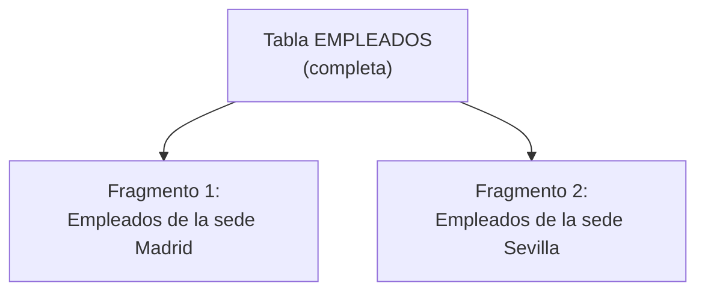

**Ejemplo**. Tabla original `EMPLEADOS(ID, NOMBRE, SEDE, SALARIO)`:

| ID | NOMBRE | SEDE | SALARIO |
|---|---|---|---|
| 1 | Ana | Madrid | 2200 |
| 2 | Luis | Sevilla | 2100 |
| 3 | Marta | Madrid | 2300 |
| 4 | Jorge | Sevilla | 1900 |

Fragmentación horizontal mediante selección (álgebra relacional):

```
F1 = σ(SEDE = 'Madrid') (EMPLEADOS)
F2 = σ(SEDE = 'Sevilla') (EMPLEADOS)
```

La **reconstrucción** se obtiene mediante la unión de los fragmentos: `EMPLEADOS = F1 ∪ F2`.

Se distinguen dos variantes:

- **Fragmentación horizontal primaria**: la condición de selección se aplica directamente sobre los atributos de la propia tabla que se fragmenta (como en el ejemplo anterior, usando `SEDE`).
- **Fragmentación horizontal derivada**: la condición de selección de una tabla se basa en la fragmentación ya realizada de otra tabla relacionada con ella (p. ej. fragmentar la tabla `PEDIDOS` según la sede a la que pertenece el `CLIENTE` que los realizó, aunque `PEDIDOS` no tenga directamente el atributo `SEDE`).

### 9.4. Fragmentación vertical

Divide la tabla **por columnas (atributos)**: cada fragmento contiene un subconjunto de las columnas de la tabla original, pero todas las filas. Para poder reconstruir la tabla original es imprescindible que **todos los fragmentos verticales conserven la clave primaria**.

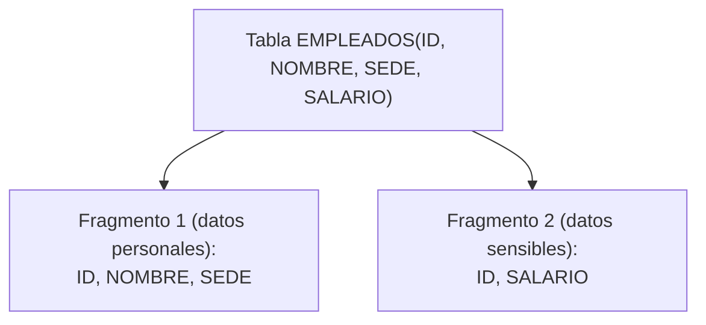

Fragmentación vertical mediante proyección:

```
V1 = π(ID, NOMBRE, SEDE) (EMPLEADOS)
V2 = π(ID, SALARIO) (EMPLEADOS)
```

La **reconstrucción** se obtiene mediante la combinación (join) de los fragmentos por la clave común: `EMPLEADOS = V1 ⋈ V2` (combinación por `ID`).

A diferencia de la fragmentación horizontal, en la vertical la clave primaria sí puede repetirse entre fragmentos (es necesario que así sea, precisamente para permitir la reconstrucción).

### 9.5. Fragmentación mixta o híbrida

Combina fragmentación horizontal y vertical: primero se fragmenta una tabla en un sentido y, sobre cada fragmento resultante, se aplica una fragmentación en el otro sentido.

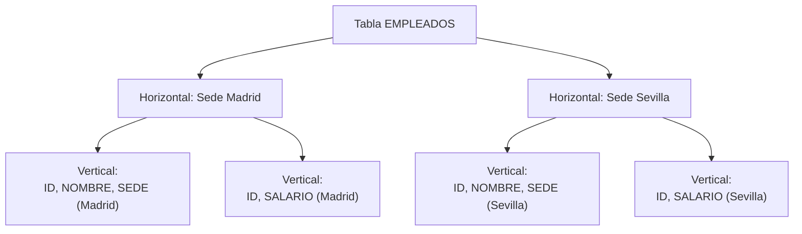

### 9.6. Comparativa de las técnicas de fragmentación

| Tipo | Divide por | Operación de fragmentación | Operación de reconstrucción | Requisito clave |
|---|---|---|---|---|
| Horizontal primaria | Filas, según sus propios atributos | Selección (σ) | Unión (∪) | Las condiciones deben ser disjuntas y completas |
| Horizontal derivada | Filas, según fragmentación de otra tabla relacionada | Selección basada en relación con otra tabla fragmentada | Unión (∪) | Debe existir una relación (clave ajena) con la tabla ya fragmentada |
| Vertical | Columnas | Proyección (π) | Combinación (⋈) | Todos los fragmentos deben conservar la clave primaria |
| Mixta / híbrida | Filas y columnas combinadas | Selección + proyección combinadas | Unión + combinación combinadas | Debe respetar las reglas de ambos tipos simultáneamente |

### 9.7. Errores frecuentes

- Olvidar la clave primaria en algún fragmento vertical: sin ella es imposible reconstruir la tabla original mediante combinación.
- Definir condiciones de fragmentación horizontal que se solapan: viola la regla de disyunción y provoca duplicidad de tuplas entre fragmentos.
- Definir condiciones de fragmentación horizontal que no cubren todos los casos posibles: viola la regla de completitud y provoca pérdida de datos al reconstruir.

---

## 10. UD01-C09. Legislación sobre protección de datos

<!-- content: UD01-C09 -->
<!-- origen: CB1.06 | RA1.i -->

### 10.1. Marco normativo vigente

La protección de los datos personales almacenados en sistemas de información está regulada, en el ámbito español y europeo, principalmente por:

- El **Reglamento General de Protección de Datos (RGPD)** — Reglamento (UE) 2016/679, de aplicación directa en todos los Estados miembros de la Unión Europea.
- La **Ley Orgánica 3/2018, de Protección de Datos Personales y garantía de los derechos digitales (LOPDGDD)**, que adapta y desarrolla el RGPD en el ordenamiento jurídico español.

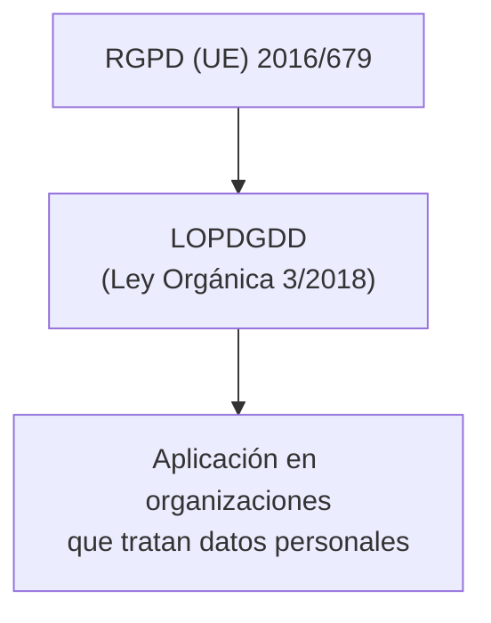

### 10.2. Principios fundamentales del tratamiento de datos

| Principio | Significado |
|---|---|
| Licitud, lealtad y transparencia | Los datos deben tratarse de forma legal, justa y de manera visible para el interesado |
| Limitación de la finalidad | Los datos solo pueden recogerse para fines determinados, explícitos y legítimos |
| Minimización de datos | Solo deben tratarse los datos estrictamente necesarios para la finalidad perseguida |
| Exactitud | Los datos deben ser exactos y mantenerse actualizados |
| Limitación del plazo de conservación | Los datos no deben conservarse más tiempo del necesario para la finalidad del tratamiento |
| Integridad y confidencialidad | Deben protegerse frente a tratamientos no autorizados, pérdida o destrucción accidental |
| Responsabilidad proactiva | Quien trata los datos debe poder demostrar el cumplimiento del resto de principios |

### 10.3. Figuras principales en el tratamiento de datos

| Figura | Rol |
|---|---|
| **Responsable del tratamiento** | Persona física o jurídica que decide los fines y medios del tratamiento de los datos |
| **Encargado del tratamiento** | Persona física o jurídica que trata los datos por cuenta del responsable, según sus instrucciones |
| **Delegado de Protección de Datos (DPO)** | Figura encargada de supervisar el cumplimiento de la normativa de protección de datos dentro de la organización; su designación es obligatoria en determinados supuestos previstos por la normativa |
| **Interesado** | Persona física titular de los datos personales objeto de tratamiento |

### 10.4. Derechos de las personas interesadas

El conjunto clásico de derechos (conocido por el acrónimo histórico **ARCO**: Acceso, Rectificación, Cancelación, Oposición) se ha ampliado con la normativa vigente hasta configurar un conjunto más completo de derechos, a veces referido de forma extendida (ARCO+ / ARSULPO):

| Derecho | Descripción |
|---|---|
| **A**cceso | Conocer qué datos personales propios están siendo tratados y con qué finalidad |
| **R**ectificación | Corregir datos personales inexactos o incompletos |
| **S**upresión ("derecho al olvido") | Solicitar la eliminación de los datos personales cuando ya no sean necesarios o proceda legalmente |
| **O**posición | Oponerse al tratamiento de los propios datos en determinadas circunstancias |
| **L**imitación del tratamiento | Solicitar que el tratamiento de los datos quede restringido en determinados supuestos |
| **P**ortabilidad | Recibir los propios datos en un formato estructurado y transmitirlos a otro responsable |

```mermaid
flowchart LR
    I["Interesado"] --> AC["Acceso"]
    I --> RE["Rectificación"]
    I --> SU["Supresión"]
    I --> OP["Oposición"]
    I --> LI["Limitación"]
    I --> PO["Portabilidad"]
```

### 10.5. Implicaciones prácticas para el diseño de bases de datos

Desde el punto de vista de quien diseña y administra una base de datos, el marco normativo de protección de datos exige, entre otras medidas:

- Aplicar el principio de **minimización de datos** desde el propio diseño del esquema (no almacenar campos innecesarios).
- Prever mecanismos técnicos que permitan atender, en tiempo razonable, los derechos de acceso, rectificación, supresión, oposición, limitación y portabilidad.
- Establecer un control de acceso adecuado (usuarios, roles, permisos) coherente con el principio de confidencialidad e integridad.
- Documentar, cuando proceda, la relación entre responsable y encargado del tratamiento (p. ej. cuando una organización externa aloja o gestiona la base de datos por cuenta de otra).

### 10.6. Errores frecuentes

- Confundir "responsable" con "encargado" del tratamiento: el responsable decide los fines del tratamiento; el encargado trata los datos siguiendo instrucciones del responsable.
- Pensar que el derecho de supresión es absoluto: existen excepciones legales que permiten conservar determinados datos pese a la solicitud del interesado (obligaciones legales, intereses públicos, etc.).
- Creer que el RGPD solo aplica a empresas europeas: también aplica, en determinados supuestos, al tratamiento de datos de ciudadanos de la UE por parte de organizaciones establecidas fuera de ella.

---

## 11. UD01-C10. Big Data e inteligencia de negocios

<!-- content: UD01-C10 -->
<!-- origen: CB1.07, CB1.07.01, CB1.07.02, CB1.07.03 | RA1.j -->

### 11.1. Concepto de Big Data

> **Big Data** hace referencia a conjuntos de datos de tal volumen, velocidad o variedad que los sistemas tradicionales de gestión de bases de datos y de procesamiento resultan insuficientes para capturarlos, almacenarlos, gestionarlos y analizarlos en un tiempo razonable.

### 11.2. Las "V" del Big Data

```mermaid
flowchart TD
    BD["Big Data"]
    BD --> VOL["Volumen\nGran cantidad de datos generados"]
    BD --> VEL["Velocidad\nRitmo al que se generan y deben procesarse los datos"]
    BD --> VAR["Variedad\nDatos estructurados, semiestructurados y no estructurados"]
    BD --> VER["Veracidad\nFiabilidad y calidad de los datos"]
    BD --> VAL["Valor\nUtilidad real que se extrae de los datos para la toma de decisiones"]
```

| V | Significado |
|---|---|
| Volumen | Cantidad masiva de datos generados continuamente por sistemas, sensores, usuarios, etc. |
| Velocidad | Ritmo al que los datos se generan y necesitan ser procesados (en tiempo real o casi real) |
| Variedad | Diversidad de formatos: datos estructurados (tablas), semiestructurados (JSON, XML) y no estructurados (texto libre, imágenes, vídeo) |
| Veracidad | Grado de fiabilidad y calidad de los datos disponibles |
| Valor | Capacidad de transformar los datos analizados en información útil para la toma de decisiones |

### 11.3. Arquitecturas de procesamiento Big Data: Lambda y Kappa

Para procesar grandes volúmenes de datos combinando procesamiento histórico (por lotes) y procesamiento en tiempo real (streaming), se han propuesto dos arquitecturas de referencia:

```mermaid
flowchart LR
    S["Fuente de datos"] --> BL["Capa batch\n(procesamiento histórico completo)"]
    S --> SL["Capa de velocidad (speed)\n(procesamiento en tiempo real)"]
    BL --> SV["Capa de servicio\n(vistas combinadas)"]
    SL --> SV
    SV --> C["Consultas / consumidores"]
```

- **Arquitectura Lambda**: combina una **capa batch** (que procesa todo el histórico de datos de forma periódica, generando vistas precisas pero con cierto retraso) con una **capa de velocidad** (que procesa los datos más recientes en tiempo real, generando vistas aproximadas y rápidas). Una **capa de servicio** combina ambas vistas para responder a las consultas.
- **Arquitectura Kappa**: simplifica la arquitectura Lambda eliminando la capa batch independiente; todo el procesamiento (histórico y en tiempo real) se realiza mediante un único motor de procesamiento de flujos (streaming), reprocesando el histórico como un flujo más cuando es necesario.

| Aspecto | Arquitectura Lambda | Arquitectura Kappa |
|---|---|---|
| Número de motores de procesamiento | Dos (batch + streaming) | Uno (streaming) |
| Complejidad de mantenimiento | Mayor (dos bases de código distintas) | Menor (una única base de código) |
| Reprocesamiento histórico | Mediante la capa batch | Reproduciendo el flujo histórico completo |

### 11.4. ETL frente a ELT

Los procesos de integración de datos desde múltiples orígenes hacia un repositorio analítico se organizan tradicionalmente en tres fases: **Extracción, Transformación y Carga**.

```mermaid
flowchart LR
    subgraph ETL["ETL: Extraer → Transformar → Cargar"]
        E1["Extracción\n(ERP, CRM, SQL, ficheros planos)"] --> T1["Transformación\n(fuera del destino)"] --> L1["Carga en el destino"]
    end
```

```mermaid
flowchart LR
    subgraph ELT["ELT: Extraer → Cargar → Transformar"]
        E2["Extracción"] --> L2["Carga en el destino (en bruto)"] --> T2["Transformación\n(dentro del propio destino)"]
    end
```

| Aspecto | ETL | ELT |
|---|---|---|
| Orden de las fases | Extraer, transformar, cargar | Extraer, cargar, transformar |
| Dónde se transforma | En un motor de transformación intermedio, antes de cargar | Directamente en el sistema de destino, aprovechando su potencia de cálculo |
| Adecuación típica | Volúmenes moderados, destinos con esquema rígido (Data Warehouse tradicional) | Grandes volúmenes, destinos con gran capacidad de cómputo (Data Lake, Lakehouse) |

**Fuentes de datos habituales en un proceso ETL/ELT**: sistemas ERP (*Enterprise Resource Planning*), sistemas CRM (*Customer Relationship Management*), consultas SQL sobre otras bases de datos, y ficheros planos (*flat files*).

### 11.5. Data Warehouse, Data Lake y Lakehouse

```mermaid
flowchart TD
    FUENTES["Fuentes de datos\n(ERP, CRM, SQL, ficheros planos)"]
    FUENTES -->|ETL| DWH["Data Warehouse\nDatos estructurados y modelados"]
    FUENTES -->|ingesta en bruto| DL["Data Lake\nDatos en bruto, cualquier formato"]
    DWH --> DM["Data Marts\n(subconjuntos departamentales)"]
    DWH --> OLAP["OLAP\n(análisis multidimensional)"]
    DL --> DM2["Procesamiento posterior\n(ELT / análisis avanzado)"]
    DWH -.integración.-> LH["Lakehouse\n(combina flexibilidad del Data Lake\ncon estructura del Data Warehouse)"]
    DL -.integración.-> LH
```

| Repositorio | Naturaleza de los datos | Esquema | Uso típico |
|---|---|---|---|
| **Data Warehouse (DWH)** | Estructurados, ya transformados e integrados | Esquema definido antes de cargar los datos ("schema on write") | Informes y análisis consolidados de negocio |
| **Data Mart** | Subconjunto departamental del Data Warehouse | Igual que el DWH, pero de alcance reducido | Análisis específico de un área concreta (ventas, finanzas...) |
| **Data Lake** | Datos en bruto, de cualquier tipo (estructurados, semiestructurados, no estructurados) | Esquema aplicado en el momento de leer los datos ("schema on read") | Almacenamiento flexible previo a su explotación analítica avanzada |
| **Lakehouse** | Combina datos en bruto con capacidades de estructuración y gobierno propias de un Data Warehouse | Mixto | Analítica avanzada manteniendo fiabilidad y gobierno de los datos |

### 11.6. Explotación de las bases de datos: de lo transaccional a la inteligencia de negocio

```mermaid
flowchart LR
    OLTP["Sistemas transaccionales\n(OLTP)"] --> DWH["Data Warehouse / Data Marts"]
    DWH --> OLAP["OLAP\n(Procesamiento analítico en línea)"]
    DWH --> DSS["Sistemas de soporte a la decisión (DSS)"]
    DWH --> DM["Minería de datos (Data Mining)"]
    DM --> BD2["Big Data"]
    BD2 --> IA["Inteligencia Artificial"]
```

- **Sistemas transaccionales (OLTP – *Online Transaction Processing*)**: gestionan las operaciones cotidianas de una organización (altas, bajas, modificaciones) con alta concurrencia y transacciones cortas.
- **Sistemas de soporte a la decisión (DSS)**: facilitan la toma de decisiones a partir de información consolidada; incluyen variantes como los sistemas de apoyo a la decisión en grupo (GDSS), los sistemas de información ejecutiva (EIS) y los sistemas de información para la gestión (MIS).
- **Almacenes de datos (Data Warehouse y Data Marts)**: consolidan y estructuran la información procedente de los sistemas transaccionales para su análisis.
- **Minería de datos (Data Mining)**: aplica técnicas estadísticas y algorítmicas para descubrir patrones no evidentes en grandes volúmenes de datos.
- **Big Data**: extiende estas capacidades a volúmenes, velocidades y variedades de datos que superan la capacidad de los enfoques tradicionales.
- **Inteligencia artificial**: constituye el nivel más avanzado de explotación de los datos, empleando modelos capaces de aprender de ellos para apoyar o automatizar decisiones.

### 11.7. Inteligencia de negocio (Business Intelligence)

La **inteligencia de negocio (BI)** agrupa el conjunto de herramientas, procesos y tecnologías orientados a transformar los datos de una organización en información útil para la toma de decisiones estratégicas. Entre sus componentes y productos habituales se encuentran:

| Elemento | Función |
|---|---|
| **Reports** | Informes periódicos y estructurados sobre indicadores de negocio |
| **Dashboards** | Paneles visuales que resumen indicadores clave de forma interactiva |
| **Data Visualization** | Representación gráfica de los datos para facilitar su interpretación |
| **Alerts** | Notificaciones automáticas ante determinadas condiciones en los datos |
| **OLAP** | Procesamiento analítico en línea mediante estructuras multidimensionales (cubos) |
| **Data Mining** | Descubrimiento de patrones y relaciones no evidentes en los datos |

### 11.8. Errores frecuentes

- Confundir "Big Data" con "mucha cantidad de datos en una base de datos relacional": Big Data implica además velocidad, variedad y, habitualmente, tecnologías de procesamiento distribuido específicas.
- Pensar que un Data Lake sustituye siempre a un Data Warehouse: ambos enfoques pueden convivir, e incluso integrarse mediante arquitecturas Lakehouse.
- Confundir ETL y ELT exclusivamente por el orden de las letras sin entender la implicación arquitectónica: en ELT la transformación se apoya en la potencia de cómputo del propio destino, lo que solo resulta viable con determinadas tecnologías de destino.

---

## 12. Conclusión / resumen

A lo largo de esta unidad se ha recorrido la evolución de los sistemas de almacenamiento de información, desde los ficheros tradicionales (secuenciales, indexados y de acceso directo) hasta los sistemas gestores de bases de datos modernos. Se ha estudiado:

- Por qué los sistemas basados exclusivamente en ficheros generan redundancia, inconsistencia y dificultades de mantenimiento, y cómo los SGBD resuelven estos problemas mediante la independencia de los datos.
- La arquitectura ANSI/SPARC de tres niveles (externo, conceptual e interno) y los dos tipos de independencia de datos (lógica y física) que de ella se derivan.
- Los componentes funcionales de un SGBD: núcleo, procesador de consultas, gestor de transacciones, lenguajes (DDL/DML/DCL), utilidades y diccionario de datos.
- Las principales clasificaciones de los SGBD: según el modelo de datos (relacional y modelos NoSQL), según el número de usuarios, según la ubicación (centralizado/distribuido) y según la licencia.
- Las particularidades de las bases de datos distribuidas, incluyendo el protocolo de confirmación en dos fases (2PC) y el teorema CAP.
- Las técnicas de fragmentación de la información (horizontal, vertical y mixta) y las reglas de completitud, reconstrucción y disyunción que deben cumplir.
- El marco normativo vigente de protección de datos (RGPD y LOPDGDD), sus principios, las figuras del responsable, el encargado y el DPO, y los derechos de las personas interesadas.
- Los conceptos fundamentales de Big Data (las "V"), las arquitecturas Lambda y Kappa, los procesos ETL/ELT y los repositorios Data Warehouse, Data Lake y Lakehouse, como base de la inteligencia de negocio.

Esta base conceptual resulta imprescindible antes de abordar, en unidades posteriores, el diseño concreto de bases de datos relacionales mediante el modelo Entidad/Relación y su implementación en un SGBD real.

## 13. Conceptos clave

- Fichero, registro, campo, campo clave
- Organización secuencial, indexada y directa (hash); colisiones y su resolución
- Base de datos, SGBD, DBMS
- Modelo de datos: jerárquico, en red, relacional, documental, clave-valor, columnas, grafos
- Arquitectura ANSI/SPARC: nivel externo, conceptual e interno
- Independencia lógica e independencia física de los datos
- Núcleo, procesador de consultas, gestor de transacciones, DDL, DML, DCL, diccionario de datos
- Clasificación de SGBD: modelo de datos, número de usuarios, ubicación, licencia
- Base de datos centralizada y distribuida
- Protocolo de confirmación en dos fases (2PC)
- Teorema CAP (Consistencia, Disponibilidad, Tolerancia a particiones)
- Fragmentación horizontal (primaria y derivada), vertical y mixta
- Reglas de completitud, reconstrucción y disyunción
- RGPD, LOPDGDD, responsable y encargado del tratamiento, DPO
- Derechos ARCO+ / ARSULPO (acceso, rectificación, supresión, oposición, limitación, portabilidad)
- Big Data: volumen, velocidad, variedad, veracidad, valor
- Arquitecturas Lambda y Kappa
- ETL frente a ELT
- Data Warehouse, Data Mart, Data Lake, Lakehouse
- OLTP, OLAP, DSS, Data Mining, Business Intelligence
