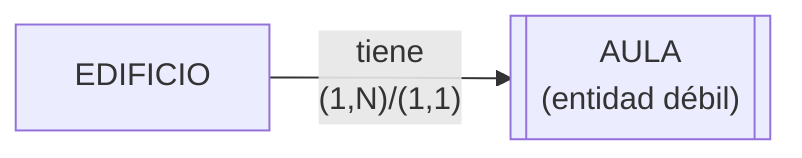
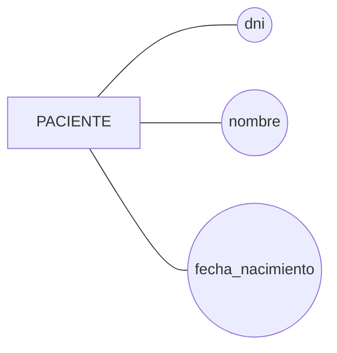
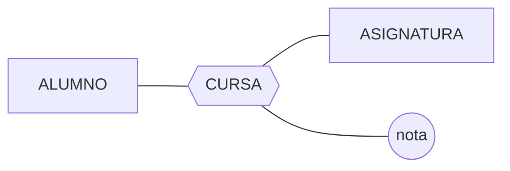
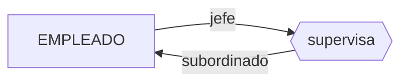
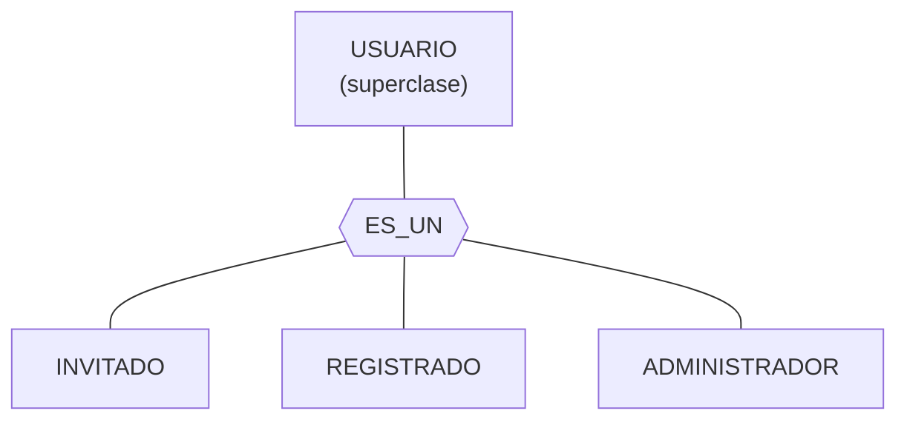
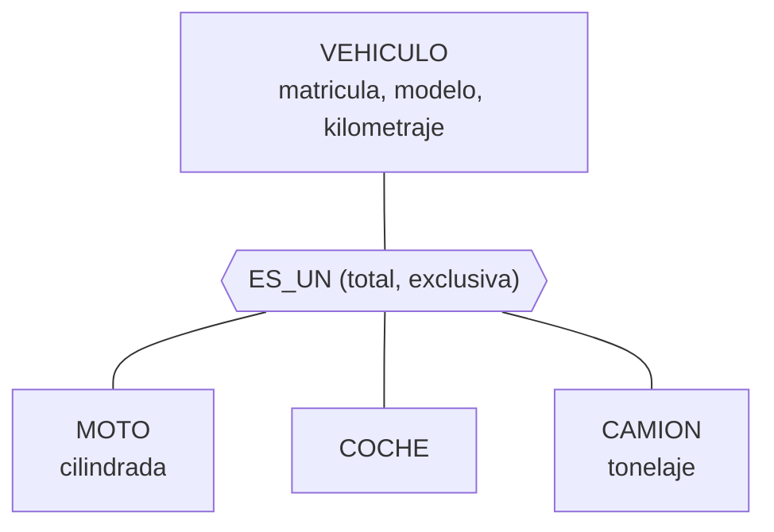
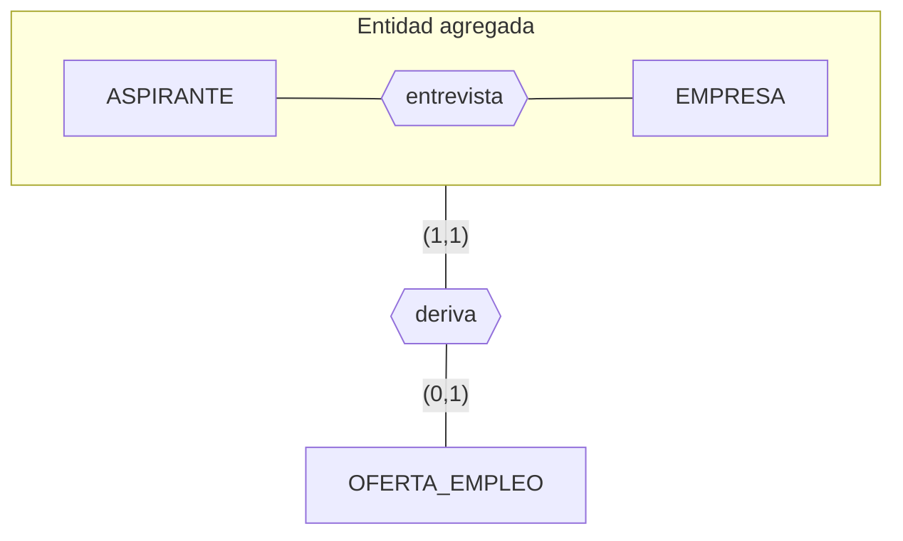
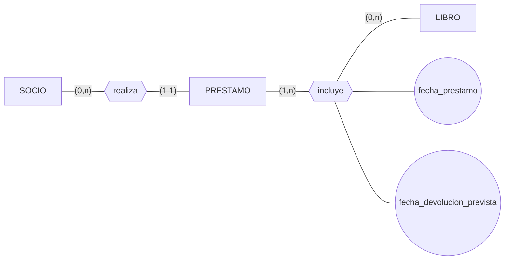

# UD02. El modelo Entidad/Relación

## 1. Introducción

Antes de construir una base de datos es necesario comprender qué información hay que almacenar, cómo se relacionan esos datos entre sí y qué restricciones deben cumplir. A esta fase se la denomina **diseño conceptual** y su herramienta de referencia es el **modelo Entidad/Relación (E/R)**, propuesto por Peter Chen en 1976.

El modelo E/R es un **modelo semántico**: no está ligado a ningún SGBD concreto ni a ninguna tecnología. Su finalidad es representar la realidad de un problema —los objetos que interesan y cómo se asocian— de forma independiente de cómo posteriormente se implemente físicamente.

El proceso completo de desarrollo de una base de datos distingue dos fases:

| Fase de Análisis | Fase de Diseño |
|---|---|
| Análisis de entidades: localizar y definir entidades y atributos | Diseño de tablas |
| Análisis de relaciones: definir relaciones entre entidades | Normalización |
| Obtención del esquema conceptual (modelo E/R) | Aplicación del enfoque relacional |
| Fusión de vistas | Diseño de transacciones |
| | Diseño de sendas de acceso |

El **esquema conceptual** obtenido con el modelo E/R debe reflejar **todos** los aspectos relevantes del mundo real que se está modelando: omitir esta fase provoca pérdida de información respecto al problema real.

En esta unidad se estudia:

1. Los elementos básicos del modelo E/R (entidades, atributos, relaciones).
2. Las cardinalidades que rigen esas relaciones.
3. La debilidad de entidades y sus dos tipos de dependencia.
4. Las extensiones del modelo E/R Extendido (restricciones sobre relaciones, generalización/especialización, agregación).
5. El procedimiento para transformar un diagrama E/R en un modelo relacional (paso a tablas).
6. Las restricciones semánticas que garantizan la integridad del modelo relacional resultante.
7. La normalización de las tablas obtenidas.

## 2. El modelo Entidad/Relación

### 2.1. Definición y finalidad

> El modelo Entidad/Relación es una **herramienta de referencia para la representación conceptual de problemas del mundo real**. Su objetivo es facilitar el diseño de bases de datos permitiendo especificar un esquema que representa la estructura lógica completa de una base de datos, partiendo de las descripciones textuales de la realidad (el **documento de especificación de requerimientos**).

Características principales del modelo E/R:

- Es un **modelo semántico**: representa el significado de los datos, no un formato de almacenamiento físico.
- No está orientado a ningún sistema físico concreto: puede describir tanto sistemas informatizados como procesos manuales (estructuras de empresa, procesos de producción, etc.).
- Favorece la representación de cualquier tipo de sistema, a cualquier nivel de abstracción.
- Se basa en dos objetos fundamentales: **entidades** y **relaciones** entre ellas.

Con el tiempo, el modelo original evolucionó dando lugar al **modelo Entidad/Relación Extendido (ERE)**, que incorpora mecanismos adicionales (generalización, especialización, agregación y restricciones sobre relaciones) para representar situaciones que el modelo básico no cubre con precisión. Ambos modelos —básico y extendido— se estudian en esta unidad.

### 2.2. El modelo E/R dentro del proceso de diseño de bases de datos

El diseño de una base de datos avanza por niveles de abstracción:


El diagrama E/R constituye el punto de partida de todo el proceso: mientras no se implemente en un SGBD concreto, el diseño es totalmente independiente de la tecnología que finalmente se utilice.

## 3. Entidades

### 3.1. Concepto de entidad

> **Entidad**: objeto real o abstracto, con características diferenciadoras capaces de hacerlo distinguir de otros objetos.

Una entidad puede ser:

- un objeto físico y concreto (un cliente, un vehículo, un edificio);
- un concepto abstracto (un préstamo, una reserva, una asignatura).

Cada entidad debe poder distinguirse del resto mediante alguna característica (o conjunto de características).

Un **conjunto de entidades** agrupa entidades que comparten las mismas características o propiedades (por ejemplo, el conjunto de entidades `CLIENTE`). Cada elemento concreto de ese conjunto es una **ocurrencia de entidad**. Es habitual usar el término "entidad" tanto para referirse al conjunto como a una ocurrencia concreta, distinguiéndose por el contexto.

> Analogía con la Programación Orientada a Objetos: entidad ≈ instancia de un objeto; conjunto de entidades ≈ clase.

**Representación gráfica**: un rectángulo con el nombre de la entidad en su interior, escrito habitualmente en mayúsculas y en singular.


### 3.2. Entidades fuertes y débiles

Las entidades se clasifican en dos tipos:

**a) Entidades fuertes o regulares.** Tienen existencia por sí mismas: su existencia no depende de la de ninguna otra entidad. Ejemplo: en una base de datos hospitalaria, la entidad `DOCTOR` no depende de la existencia de `PACIENTE`. Se representan mediante un rectángulo simple.

**b) Entidades débiles.** Su existencia depende de la existencia de otra entidad (la entidad fuerte asociada), y sus propios atributos no bastan para identificarlas de forma completa: solo la identifican de forma parcial. Deben participar necesariamente en una relación que ayude a completar su identificación.

Ejemplo clásico: las entidades `EDIFICIO` y `AULA`. Puede haber aulas con la misma numeración pero en edificios diferentes, por lo que el número de aula por sí solo no identifica de forma unívoca cada ocurrencia; es necesario conocer también en qué edificio está.

Se representan mediante un **rectángulo doble**.



#### Tipos de dependencia de las entidades débiles

Las entidades débiles presentan dos posibles tipos de dependencia respecto de la entidad fuerte con la que se relacionan:

- **Dependencia en existencia**: si desaparece una ocurrencia de la entidad fuerte, desaparecen también las ocurrencias de la entidad débil que dependían de ella. Se representa incluyendo una **E** en el interior de la relación débil.
- **Dependencia en identificación**: además de la dependencia en existencia, la ocurrencia de la entidad débil **no puede identificarse por sí misma**, debiendo hacerse necesariamente mediante la clave de la entidad fuerte asociada. Se representa incluyendo una **ID** en el interior de la relación débil.

Toda dependencia en identificación implica dependencia en existencia, pero no al revés: puede haber entidades cuya existencia dependa de otra sin que su identificación dependa de ella (por ejemplo, un `FAMILIAR` a cargo en una base de datos hospitalaria puede requerir que exista el paciente titular —dependencia en existencia— pero, si el familiar tiene su propio DNI, se identifica por sí mismo, sin dependencia en identificación).

**Comprobación de comprensión.** ¿Cuál de estas entidades no podría considerarse débil: `PROVEEDOR`, `PAGO`, `FAMILIAR`? Respuesta: `PROVEEDOR`, porque puede existir por sí mismo y posee atributos propios (por ejemplo, CIF) que lo identifican sin necesitar de otra entidad.

## 4. Atributos

### 4.1. Concepto

> **Atributo**: cada una de las propiedades o características que tiene un tipo de entidad o un tipo de relación. Los atributos toman valores de uno o varios **dominios**.

El **dominio** de un atributo es el conjunto de valores permitidos para dicho atributo. Varios atributos pueden compartir el mismo dominio (por ejemplo, `nombre`, `apellido_1` y `apellido_2` de la entidad `PACIENTE` comparten el dominio de cadenas de caracteres de cierta longitud).

**Representación gráfica**: una elipse con el nombre del atributo (en minúscula) conectada mediante una línea a la entidad o relación a la que pertenece.



### 4.2. Tipos de atributos

**a) Obligatorios / opcionales**
- **Obligatorio**: debe estar siempre definido para la entidad o relación (toda clave es un atributo obligatorio).
- **Opcional**: puede no estar definido en algunas ocurrencias.

**b) Atómicos / compuestos**
- **Atómico o simple**: no puede dividirse en partes con significado propio (ej. `dni`).
- **Compuesto**: puede descomponerse en subatributos con significado propio (ej. `dirección` = `calle` + `número` + `localidad`).

**c) Monovaluados / multivaluados**
- **Monovaluado**: un único valor por ocurrencia de entidad (ej. `dni`).
- **Multivaluado**: puede tomar varios valores distintos para la misma ocurrencia (ej. varias direcciones de e-mail de un mismo empleado).

Para atributos multivaluados se define su **cardinalidad**, que indica el número mínimo y máximo de valores que puede tomar, expresado como `(mínimo, máximo)`:
- **Cardinalidad mínima**: 0 (el atributo puede no tener valor) o 1 (debe tener al menos un valor).
- **Cardinalidad máxima**: 1 (un único valor) o `n` (múltiples valores, sin límite concreto).

Ejemplo: el atributo `e_mail` con cardinalidad `(0,n)` indica que un empleado puede no tener ninguna dirección o puede tener varias.

**d) Derivados / almacenados**
- **Almacenado**: se guarda directamente su valor.
- **Derivado**: su valor se puede calcular a partir de otros atributos. Ejemplo clásico: la `edad`, calculable a partir de la `fecha_nacimiento`.

### 4.3. Claves

Identificar de forma unívoca cada ocurrencia de una entidad es fundamental para poder tratar correctamente la información. Se definen los siguientes conceptos:

- **Superclave (superllave)**: cualquier conjunto de atributos que permite identificar de forma única a una ocurrencia de entidad. Puede incluir atributos redundantes que no serían estrictamente necesarios.
- **Clave candidata**: una superclave de la que no puede eliminarse ningún atributo sin dejar de ser superclave (es decir, es una superclave *mínima*).
- **Clave primaria (Primary Key)**: la clave candidata elegida por el diseñador para identificar unívocamente cada ocurrencia. No puede contener valores nulos.
- **Claves alternativas**: el resto de claves candidatas no elegidas como clave primaria.

**Representación gráfica de la clave primaria**: si los atributos se representan con elipses, se subraya el nombre del atributo o atributos que la forman; si se representan con círculos, se emplea un círculo relleno (negro) para los atributos clave.

**Ejemplo resuelto.** Sea la entidad `TRABAJADOR` con los atributos `nombre`, `apellido_1`, `apellido_2`, `dni`, `numero_afiliacion_ss`, `fecha_nacimiento` y `codigo_empresa`. Tanto `dni` como `numero_afiliacion_ss` son claves candidatas válidas (identifican unívocamente al trabajador). Si el diseñador elige `dni` como clave primaria, `numero_afiliacion_ss` queda como clave alternativa. El conjunto `{nombre, apellido_1, apellido_2}` **no** es una clave candidata válida, porque pueden existir varios trabajadores con el mismo nombre completo.

### 4.4. Atributos de una relación

Las relaciones también pueden tener atributos propios que las describan. Ejemplo: la relación `CURSA` entre `ALUMNO` y `ASIGNATURA` puede tener el atributo `nota`, que solo tiene sentido asociado al hecho de que un alumno concreto curse una asignatura concreta (no pertenece únicamente a `ALUMNO` ni únicamente a `ASIGNATURA`).

Otro caso típico son las relaciones que registran históricos (fecha, hora de un evento), como la relación entre `CLIENTE` y `FACTURA` que necesita guardar la fecha de emisión.



## 5. Relaciones

### 5.1. Concepto

> **Relación**: asociación entre diferentes entidades. En una relación no pueden aparecer dos veces relacionadas las mismas ocurrencias de entidad.

**Representación gráfica**: un rombo con el nombre de la relación en su interior, conectado mediante líneas rectas a las entidades que asocia. El nombre de una relación suele expresarse con un **verbo en singular** (forman, poseen, atiende, contrata, imparte...), mientras que las entidades se nombran con **sustantivos en singular**.

En relaciones reflexivas (una entidad consigo misma) es habitual indicar el **rol** que desempeña cada entidad en cada extremo de la relación.

Para describir completamente una relación es necesario conocer tres aspectos: su **grado**, su **cardinalidad** y la **cardinalidad de las entidades** participantes.

### 5.2. Grado de una relación

> **Grado de una relación**: número de entidades que participan en ella.

| Grado | Nombre | Descripción |
|---|---|---|
| 1 | Unaria, reflexiva o recursiva | Participa una única entidad (relacionada consigo misma) |
| 2 | Binaria | Participan dos entidades. Es el tipo más habitual y el que se busca priorizar tras los refinamientos del esquema |
| 3 | Ternaria | Participan tres entidades simultáneamente |
| n | N-aria | Participan n entidades; poco usuales, conviene simplificarlas a relaciones de menor grado |
| — | Doble | Dos entidades relacionadas mediante dos relaciones distintas |

**Ejemplo de relación unaria (reflexiva)**: la relación `supervisa` entre ocurrencias de la entidad `EMPLEADO`, donde un empleado puede ejercer el rol de **jefe** sobre otros empleados o el rol de **subordinado** respecto de otro.



### 5.3. Cardinalidad de relaciones

> **Cardinalidad de una relación**: número máximo de ocurrencias de cada entidad que pueden intervenir en una ocurrencia de relación. Se expresa siempre para relaciones binarias.

Se distinguen cuatro tipos de correspondencia:

- **Uno a uno (1:1)**: una ocurrencia de A se relaciona con, como mucho, una ocurrencia de B, y viceversa. Ejemplo: `ALUMNO` – `EXPEDIENTE` (un alumno tiene un único expediente y un expediente pertenece a un único alumno).
- **Uno a muchos (1:N)**: una ocurrencia de A se relaciona con varias de B, pero cada ocurrencia de B solo se relaciona con una de A. Ejemplo: `DOCENTE` – `ASIGNATURA` (un docente puede impartir varias asignaturas, pero cada asignatura solo la imparte un docente).
- **Muchos a uno (N:1)**: es la lectura inversa de 1:N. Ejemplo: `JUGADOR` – `EQUIPO` (muchos jugadores pertenecen a un mismo equipo).
- **Muchos a muchos (M:N)**: una ocurrencia de A puede relacionarse con varias de B y viceversa. Ejemplo: `ALUMNO` – `ASIGNATURA` a través de `CURSA` (un alumno se matricula en varias asignaturas y una asignatura tiene varios alumnos matriculados).


Las notaciones de cardinalidad varían según el autor (Chen, pata de cuervo, Bachman...); en esta unidad se emplea principalmente la etiqueta explícita `1:1`, `1:N`, `N:1` o `M:N` junto a la relación.

### 5.4. Cardinalidad de entidades (participación)

> La **cardinalidad de una entidad** en una relación especifica el número mínimo y máximo de ocurrencias de la relación en las que puede tomar parte cada ejemplar de esa entidad.

Se representa mediante una pareja `(mínimo, máximo)` situada **junto a la entidad opuesta** a la que describe (es decir, en el lado contrario de la relación):

- **Cardinalidad mínima**: 0 (participación **opcional** o parcial) o 1 (participación **obligatoria** o total).
- **Cardinalidad máxima**: 1 (como mucho una relación) o `n` (varias relaciones posibles).

**Ejemplo.** Un `JUGADOR` pertenece como mínimo a ningún equipo y como máximo a uno: `(0,1)`. Un `EQUIPO` tiene como mínimo un jugador y como máximo varios: `(1,n)`.


> Nota: la etiqueta `(0,1)` de `JUGADOR` se coloca junto a `EQUIPO` porque indica cuántas veces puede aparecer una ocurrencia de `JUGADOR`; la etiqueta `(1,n)` de `EQUIPO` se coloca junto a `JUGADOR` por el mismo motivo.

**Comprobación de comprensión.** Un usuario registrado puede crear las partidas que desee (o ninguna); una partida solo puede haber sido creada por un único usuario. Las cardinalidades correctas junto a `USUARIO` y `PARTIDA` en la relación `CREAR` son `(1,1)` y `(0,N)` respectivamente: cada partida (extremo `PARTIDA`) exige exactamente un usuario creador —de ahí el `(1,1)` situado junto a `USUARIO`—, mientras que cada usuario puede crear cero o varias partidas —de ahí el `(0,N)` situado junto a `PARTIDA`—.

## 6. Debilidad de entidades: síntesis

*(Contenido ya desarrollado en el apartado 3.2; se recopila aquí como cierre del bloque conceptual C04, en coherencia con la secuenciación curricular de la unidad).*

Recordemos los puntos clave:

1. Una entidad es **débil** cuando sus propios atributos no bastan para identificar sin ambigüedad cada ocurrencia.
2. Debe existir una relación con una entidad **fuerte** que aporte la información necesaria para completar su identificación.
3. Existen dos grados de dependencia: **en existencia** (E) y **en identificación** (ID), siendo la segunda más restrictiva que la primera.
4. Gráficamente: la entidad débil se dibuja con **rectángulo doble** y la relación que la vincula con la entidad fuerte suele marcarse con **E** o **ID** según el tipo de dependencia.

Esta distinción es determinante más adelante, en el paso al modelo relacional (apartado 9), puesto que **toda entidad débil hereda en su tabla la clave primaria de la entidad fuerte de la que depende**, formando parte de su propia clave primaria (cuando la dependencia es en identificación) o como clave foránea (cuando la dependencia es solo en existencia).

## 7. El modelo E/R ampliado (Extendido)

El modelo E/R básico resulta insuficiente para representar con precisión ciertas situaciones (relaciones con cardinalidad N:M complejas, jerarquías de tipos, relaciones entre relaciones). El **modelo Entidad/Relación Extendido (ERE)** incorpora tres grandes extensiones:

1. Restricciones sobre las relaciones.
2. Generalización y especialización (jerarquías).
3. Agregación.

### 7.1. Restricciones sobre las relaciones

Se aplican cuando una entidad participa en **varias relaciones simultáneas** y es necesario acotar cómo puede combinarse esa participación:

| Restricción | Descripción | Representación |
|---|---|---|
| **Exclusividad** | Una ocurrencia de la entidad solo puede participar en **una** de las relaciones, nunca en ambas a la vez. Ejemplo: un `MUSICO` *dirige* una `ORQUESTA` o *toca* en ella, pero no ambas cosas simultáneamente | Arco que engloba las relaciones exclusivas |
| **Exclusión** | Las ocurrencias de las entidades solo pueden asociarse mediante **una única** relación en cada momento (no simultáneamente por dos relaciones distintas). Ejemplo: un monitor puede *impartir* o *recibir* un curso, pero no ambas cosas para el mismo curso a la vez | Línea discontinua entre las dos relaciones |
| **Inclusividad** | Para que dos ocurrencias se asocien mediante una relación, deben haber estado asociadas previamente mediante otra. Ejemplo: un monitor debe *recibir* los cursos de nutrición y primeros auxilios antes de poder *impartir* el curso de cocina | Arco terminado en flecha, con la cardinalidad de la restricción `(mín,máx)` |
| **Inclusión** | Restricción más fuerte que la anterior: toda ocurrencia asociada mediante una relación debe estar asociada **a la misma ocurrencia concreta** mediante la otra relación. Ejemplo: un hombre solo puede *divorciarse* de la misma mujer con la que *se casó* | Similar a la inclusividad, pero exige coincidencia exacta de la ocurrencia |

**Comprobación de comprensión.** *"Para que un hombre se divorcie de una mujer, primero ha de haber estado casado con ella"* — esta frase describe una **restricción de inclusión**: obliga a que exista previamente la relación `se_casa` y, además, que sea exactamente con la misma ocurrencia de la otra entidad.

### 7.2. Generalización y especialización

Cuando varios conjuntos de entidades comparten **atributos comunes** además de tener **atributos propios diferenciadores**, conviene modelar una jerarquía:

- **Superclase (supertipo)**: entidad de nivel superior que agrupa las características comunes.
- **Subclase (subtipo)**: entidad de nivel inferior con las características específicas.
- **Generalización**: proceso de reunir varias subclases en una superclase común.
- **Especialización**: proceso inverso, dividir una superclase en subclases según sus diferencias.
- **Herencia**: los atributos (y las relaciones en las que participa) de la superclase son heredados automáticamente por todas sus subclases.

La relación superclase–subclase se expresa mediante la notación **ES_UN** (en inglés, **IS_A**), y se representa gráficamente con un **triángulo invertido**: la superclase queda por encima y las subclases se conectan mediante líneas rectas.



#### Restricciones semánticas de la jerarquía

Toda generalización/especialización puede clasificarse según dos ejes independientes:

| Eje | Valor | Significado |
|---|---|---|
| Cobertura | **Total** | Todo ejemplar de la superclase pertenece a alguna subclase |
| Cobertura | **Parcial** | Puede haber ejemplares de la superclase que no pertenezcan a ninguna subclase |
| Solapamiento | **Con solapamiento** | Un mismo ejemplar de la superclase puede pertenecer simultáneamente a varias subclases |
| Solapamiento | **Exclusiva** | Un ejemplar de la superclase pertenece, como mucho, a una única subclase |

**Ejercicio resuelto (documento de apoyo).** Sean las entidades `TURISMO` (con atributos `Num_bastidor`, `Fecha_fab`, `precio`, `Num_puertas`) y `CAMION` (con atributos `Num_bastidor`, `Fecha_fab`, `precio`, `Num_ejes`, `Tonelaje`). Al compartir atributos comunes (`Num_bastidor`, `Fecha_fab`, `precio`) y tener atributos específicos, se establece una superclase `VEHICULO` con esos atributos comunes, y las subclases `TURISMO` y `CAMION` conservan únicamente sus atributos propios. La jerarquía resultante es **parcial con solapamiento**.

**Ejemplo aplicado (práctica de Autoescuela).** En un caso real de gestión de una autoescuela aparecen dos jerarquías con restricciones distintas:

- `PROFESOR` → subclases `PROF_TEORIA` y `PROF_PRACTICA`: jerarquía **total e inclusiva (solapada)** (todo profesor pertenece a alguna de las dos categorías, y puede pertenecer a ambas a la vez).
- `VEHICULO` → subclases `MOTO`, `COCHE` y `CAMION`: jerarquía **total y exclusiva** (todo vehículo pertenece a exactamente una de las tres categorías, nunca a más de una).



### 7.3. Agregación

El modelo E/R básico no permite representar relaciones entre relaciones. La **agregación** es la abstracción que soluciona este problema: trata una relación (junto con las entidades que asocia) como si fuera una **entidad de nivel superior**, que puede a su vez participar en otras relaciones.

**Representación gráfica**: un rectángulo que engloba las entidades y la relación que se agregan, formando la nueva "entidad agregada". La cardinalidad de la entidad agregada en la nueva relación siempre es `(1,1)` (no se indica explícitamente).

Existen dos tipos de agregación:

- **Compuesto/componente**: el todo se forma por la unión de partes de **distinto** tipo, cada una con un rol diferente. Ejemplo: un coche compuesto por motor, chasis y ruedas (tipos distintos, roles distintos).
- **Miembro/colección**: el todo se forma por la unión de partes del **mismo** tipo, todas con el mismo rol. Puede incluir una restricción de orden entre los miembros. Ejemplo: el alumnado de una clase (todos los alumnos juegan el mismo rol).

**Ejemplo del documento de apoyo.** Una empresa de selección de personal realiza `ENTREVISTAS` a `ASPIRANTES`; de algunas de esas entrevistas puede derivarse una `OFERTA_EMPLEO`. Como la oferta se relaciona con la propia relación *entrevista* (no directamente con una entidad simple), es necesario **agregar** la relación `ENTREVISTA` (junto con `ASPIRANTE` y la empresa) para poder conectarla después con `OFERTA_EMPLEO`.



**Comprobación de comprensión.** Representar el alumnado perteneciente a una clase mediante una agregación **compuesto/componente** sería incorrecto: al ser todos los alumnos elementos del mismo tipo que desempeñan el mismo rol, corresponde una agregación de tipo **miembro/colección**.

## 8. Elaboración de diagramas E/R: procedimiento

### 8.1. Identificación de entidades y relaciones

Punto de partida: el **documento de especificación de requerimientos** (el enunciado del problema). Cuanto más completo y detallado, mejor.

Pistas lingüísticas para localizar los elementos del modelo (tutorial *pasos a seguir en E-R*):

| Elemento del lenguaje natural | Suele corresponder a |
|---|---|
| Sustantivos (sujetos o complementos directos) | Entidades (aunque a veces son atributos) |
| Nombres propios | Ocurrencias concretas de entidad |
| Verbos | Relaciones |
| Preposiciones/frases preposicionales entre nombres | Relaciones o atributos |

Reglas para confirmar si un elemento es realmente una entidad (y no un atributo):

1. Tiene existencia propia.
2. Cada ejemplar puede diferenciarse del resto.
3. Todos los ejemplares comparten las mismas propiedades.

### 8.2. Identificación de atributos, claves y jerarquías

- **Atributos**: buscar en el documento de requerimientos características, propiedades o cualidades de cada entidad/relación. Determinar si son simples/compuestos y derivados/almacenados.
- **Claves**: de entre los atributos de cada entidad, determinar las claves candidatas y elegir la clave primaria. Este proceso permite además determinar si la entidad es fuerte (tiene alguna clave candidata) o débil (no tiene ninguna).
- **Jerarquías**: si varias entidades comparten atributos junto con atributos propios diferenciadores, valorar establecer una generalización/especialización, determinando si es total/parcial y exclusiva/con solapamiento.

### 8.3. Metodologías de elaboración

| Metodología | Estrategia |
|---|---|
| **Descendente (Top-Down)** | Se parte de un esquema general muy abstracto y se refina progresivamente en niveles con más detalle |
| **Ascendente (Bottom-Up)** | Se parte de los atributos (nivel más bajo), se agrupan en entidades y después se construyen relaciones y jerarquías |
| **Dentro-fuera (Inside-Out)** | Se comienza el esquema en una zona concreta y se va ampliando a medida que se analiza el resto de la especificación |
| **Mixta** | Se dividen los requerimientos en subconjuntos (técnica descendente) y cada subconjunto se desarrolla de forma ascendente |

No existe una metodología universalmente superior: la elección depende del problema y de la experiencia del diseñador, que habitualmente termina combinando varias.

### 8.4. Redundancia en diagramas E/R

> **Redundancia**: almacenamiento del mismo dato varias veces en diferentes lugares del esquema.

Problemas asociados a la redundancia no controlada:

- Mayor carga de trabajo (hay que actualizar el dato en varios sitios).
- Mayor gasto de espacio de almacenamiento.
- **Inconsistencia**: cuando el dato se actualiza en un lugar pero no en otro.

Indicios habituales de redundancia:

- Atributos derivados (su contenido se calcula a partir de otros atributos).
- **Ciclos**: varias entidades unidas circularmente mediante distintas relaciones. Antes de eliminar una relación de un ciclo por considerarla redundante hay que comprobar que: (a) el significado de las relaciones del ciclo es equivalente; (b) al eliminar la relación redundante el significado del resto no cambia; (c) los atributos de la relación eliminada pueden reasignarse a alguna entidad sin pérdida de significado.

No toda redundancia es perjudicial: en ocasiones se introduce **redundancia controlada** por motivos de rendimiento (por ejemplo, si el cálculo de un atributo derivado es muy costoso).

### 8.5. Propiedades deseables de un diagrama E/R

| Propiedad | Definición |
|---|---|
| **Completitud** | Todo requerimiento tiene su representación en el diagrama, y viceversa |
| **Corrección sintáctica** | No hay representaciones erróneas del lenguaje del modelo |
| **Corrección semántica** | Las representaciones significan exactamente lo que dice el requerimiento (errores típicos: confundir atributo con entidad, entidad con relación, cardinalidades erróneas u omitidas) |
| **Minimalidad** | Si se elimina cualquier elemento, se pierde información (no hay elementos redundantes) |
| **Sencillez** | Se representan los requerimientos de la forma más simple posible |
| **Legibilidad** | El diagrama se interpreta con facilidad (disposición clara de los elementos) |
| **Escalabilidad** | Es capaz de incorporar cambios derivados de nuevos requerimientos |

**Comprobación de comprensión.** Si un atributo que en realidad pertenece a una relación se asocia erróneamente a una entidad, se está incumpliendo la **corrección semántica** del diagrama.

## 9. Paso del diagrama E/R al modelo relacional

### 9.1. Simplificación previa del esquema conceptual

Antes de aplicar las reglas de transformación es necesario simplificar el diagrama E/R hasta obtener lo que se denomina **Esquema Conceptual Modificado (ECM)**, en el que solo existen entidades fuertes con sus atributos y relaciones jerárquicas (1:N). Las transformaciones necesarias son:

1. **Transformación de atributos compuestos**: se descomponen en sus atributos simples.
2. **Transformación de atributos multivaluados**: se convierten en una nueva entidad relacionada con la original, con un único atributo (el que era multivaluado). Esa nueva entidad puede resultar débil si su atributo no basta como clave primaria propia.
3. **Transformación de relaciones muchos a muchos (M:N) en jerárquicas (1:N)**: se crea una nueva entidad intermedia cuya clave está formada por las claves de las dos entidades originales; la relación M:N se sustituye por dos relaciones 1:N desde cada entidad original hacia la nueva entidad intermedia. Si la relación M:N tenía atributos propios, pasan a ser atributos de la nueva entidad.

   ```mermaid
   flowchart LR
       A["Entidad A"] -- "1:N" --> AB["Entidad A_B\n(clave: clave_A + clave_B)"]
       B["Entidad B"] -- "1:N" --> AB
   ```

4. **Transformación de relaciones cíclicas**: se elimina el ciclo creando una nueva entidad cuya clave está formada por dos atributos que recogen las claves de las ocurrencias relacionadas; se establecen dos nuevas relaciones cuya cardinalidad dependerá de la cardinalidad original de la relación cíclica.
5. **Transformación de relaciones ternarias**: se tratan de forma análoga a los atributos asociados a una relación: si en lugar de un conjunto de atributos lo que se asocia es una entidad completa, esta se conecta mediante una nueva relación a la entidad resultante de "resolver" la relación ternaria (ver apartado 9.2).
6. **Conversión de entidades débiles en fuertes**: se añaden a la entidad débil los atributos clave de la entidad fuerte de la que depende. La clave de la nueva entidad (ya fuerte) estará formada por esos atributos añadidos junto con los atributos clave propios de la entidad débil original.

**Ejemplo resuelto.** La entidad `ALUMNADO` participa en la relación M:N `COLABORA` con la entidad `GRUPO_TRABAJO`, con el atributo `fecha_colaboracion` asociado a la relación. Al transformar la relación M:N se crea una nueva entidad `ALUMNADO_GRUPO`, cuya clave está formada por las claves primarias de `ALUMNADO` y `GRUPO_TRABAJO`, y que recibe como atributo propio `fecha_colaboracion` (el atributo que antes pertenecía a la relación).

### 9.2. Transformación de relaciones ternarias

Para las relaciones donde intervienen tres entidades, el procedimiento de transformación siempre genera **una nueva tabla** que contiene como atributos las claves primarias de las tres entidades interrelacionadas más los atributos propios de la interrelación. La **clave primaria** de esa nueva tabla depende de la **conectividad** de la relación ternaria (M, N y P representan "muchos"; 1 representa "uno"):

Para determinar la conectividad de cada extremo, se fija una ocurrencia concreta de las otras dos entidades y se pregunta: *¿con cuántas ocurrencias de esta tercera entidad puede combinarse?* Si la respuesta es "solo una", ese extremo se conecta con **uno**; si es "varias", se conecta con **muchos**.

| Conectividad | Clave primaria de la tabla resultante |
|---|---|
| **M:N:P** | Las claves primarias de las **tres** entidades |
| **M:N:1** | Las claves primarias de las entidades de los lados etiquetados **M** y **N** (no la del lado etiquetado con 1) |
| **N:1:1** | La clave primaria de la entidad etiquetada con **N** más la clave de **cualquiera** de las dos entidades etiquetadas con 1 |
| **1:1:1** | Las claves primarias de **dos cualesquiera** de las tres entidades |

**Ejemplo (Tutorial Relaciones Ternarias).** La relación `clase` asocia las entidades `ASIGNATURA`, `AULA` y `HORA_SEMANAL`. Razonando extremo a extremo:
- Fijadas un `aula` y una `hora_semanal`, solo puede impartirse **una** `asignatura` → `asignatura` se conecta con **uno**.
- Fijadas una `asignatura` y un `aula`, puede impartirse en **varias** `horas_semanales` → `hora_semanal` se conecta con **muchos**.
- Fijadas una `asignatura` y una `hora_semanal`, solo puede usarse **una** `aula` → `aula` se conecta con **uno**.

La conectividad resultante es **N:1:1** (siendo N el lado de `hora_semanal`). La tabla resultante `CLASE` tendría como clave primaria la clave de `hora_semanal` junto con la clave de `asignatura` **o** la de `aula` (cualquiera de las dos, al ser ambas de conectividad 1).

### 9.3. Reglas generales de paso a tablas

Una vez obtenido el Esquema Conceptual Modificado, la transformación al modelo relacional es prácticamente automática:

1. **Toda entidad se transforma en una tabla.**
2. **Todo atributo se transforma en una columna** de su tabla correspondiente.
3. **El atributo clave de la entidad se convierte en clave primaria de la tabla** (se representa subrayado).
4. **Entidad débil**: genera una tabla con todos sus atributos propios, a la que se añaden los atributos clave de la entidad fuerte relacionada; estos atributos añadidos actúan como **clave foránea** hacia la entidad fuerte. Después se determina la clave primaria de la nueva tabla (que, en caso de dependencia en identificación, incluirá la clave foránea).
5. **Relaciones 1:1**: pueden generar una nueva tabla o bien **propagar la clave** de una de las entidades hacia la otra (como clave foránea), en función de la cardinalidad de participación.
6. **Relaciones 1:N**: pueden generar una nueva tabla o propagar la clave de la entidad del lado "1" hacia la tabla del lado "N" (clave foránea).
7. **Relaciones reflexivas/cíclicas**: generan una o varias tablas en función de su cardinalidad, siguiendo el mismo criterio que las relaciones 1:1 o 1:N según corresponda.
8. **Jerarquías (generalización/especialización)**: dan lugar a la reunión, eliminación o creación de relaciones 1:1 entre la superclase y cada subclase, según el tipo de jerarquía.
9. **Relaciones M:N**: se transforman en una **nueva tabla** cuya clave primaria está formada por las claves primarias de las entidades que asocia (más los posibles atributos propios de la relación).

**Ejercicio resuelto.** Sea la relación `LABORAL` de cardinalidad 1:N entre `EMPRESA` (entidades atributos: `Codigo_empresa`, `razon_social`, `domicilio`, `Nº_Trabajadores`) y `TRABAJADOR` (`DNI`, `Nombre`, `Apellido1`, `Apellido2`, `Num_SS`). El paso a tablas, propagando la clave desde el lado "1" (`EMPRESA`) hacia el lado "N" (`TRABAJADOR`), resulta:

```
EMPRESA (Codigo_empresa, razon_social, domicilio, Nº_Trabajadores)
TRABAJADOR (DNI, Nombre, Apellido1, Apellido2, Num_SS, Codigo_empresa)
```

donde `Codigo_empresa` en `TRABAJADOR` actúa como clave foránea referenciando a `EMPRESA`.

## 10. Restricciones semánticas del modelo relacional

Una vez obtenido el esquema de tablas, es necesario garantizar que la base de datos mantenga la **integridad** de la información, es decir, que refleje siempre datos consistentes con la realidad modelada. Las restricciones semánticas más habituales del modelo relacional son:

- **Restricción de dominio**: cada atributo solo puede tomar valores pertenecientes a su dominio definido (tipo de dato y rango de valores permitido).
- **Restricción de clave (integridad de entidad)**: la clave primaria de una tabla no puede contener valores nulos y debe ser única para cada fila, garantizando que toda ocurrencia se identifica sin ambigüedad.
- **Restricción de integridad referencial**: todo valor de una clave foránea debe corresponder con un valor existente de la clave primaria a la que referencia (o ser nulo, si la participación es opcional), de modo que no puedan existir referencias a filas inexistentes.
- **Restricciones definidas por el usuario**: reglas propias del dominio del problema que no se derivan directamente de la estructura de tablas y claves (por ejemplo, que un descuento no pueda superar un determinado porcentaje). Estas restricciones no siempre pueden expresarse completamente mediante el diseño lógico (tablas, claves y relaciones); en tal caso deben quedar **documentadas aparte**, como restricciones semánticas que el sistema deberá aplicar mediante otros mecanismos (validaciones, disparadores, programación).

> Estas restricciones deben verificarse siempre después de completar el paso a tablas del apartado 9, antes de proceder al proceso de normalización descrito a continuación, para asegurar que el esquema lógico obtenido es coherente con el esquema conceptual del que procede.

## 11. Normalización de modelos relacionales

### 11.1. Concepto y finalidad

> **Normalización**: proceso, propuesto por E. F. Codd en 1972, que consiste en imponer a las tablas del modelo relacional una serie de restricciones mediante transformaciones consecutivas. Garantiza que las tablas contienen los atributos necesarios y suficientes para describir la entidad que representan, separando aquellos atributos que por su contenido deberían formar parte de otra tabla.

La normalización se aplica **después** del paso a tablas (traducción del esquema conceptual al esquema lógico), como proceso de refinamiento, y persigue dos objetivos:

- Suprimir dependencias erróneas entre atributos.
- Optimizar las operaciones de inserción, modificación y borrado.

El proceso avanza por etapas consecutivas: **1ª, 2ª, 3ª Forma Normal, Forma Normal de Boyce-Codd**, y otras formas normales adicionales (4ª, 5ª, Dominio-Clave). Cada forma normal exige requisitos cada vez más restrictivos, y **no puede alcanzarse una forma normal sin haber satisfecho antes la anterior**. Como norma general, se recomienda normalizar como mínimo hasta 3FN, o hasta FNBC si es posible.

### 11.2. Tipos de dependencias entre atributos

- **Dependencia funcional (A → B)**: dados los atributos A y B, se dice que B depende funcionalmente de A si para cada valor de A existe un único valor de B. A es el **determinante**.
- **Dependencia funcional completa**: B depende funcionalmente completa de un conjunto de atributos {A1, A2, ..., Ak} si depende funcionalmente del conjunto entero, pero no de ninguno de sus subconjuntos propios.
- **Dependencia transitiva**: existe entre A y C si B depende funcionalmente de A y C depende funcionalmente de B (A → B → C).

**Ejercicio resuelto.** Sean las tablas:

```
EMPLEADO (DNI, Nombre, Direccion, Localidad, Cod_Localidad, Nombre_hijo, Edad_hijo)
LIBRO (Titulo_libro, Num_ejemplar, Autor, Editorial, Precio)
```

- En `EMPLEADO`, `Nombre` y `Direccion` dependen funcionalmente de `DNI` (`DNI → Nombre`, `DNI → Direccion`). En cambio, `Nombre_hijo` y `Edad_hijo` no dependen funcionalmente de `DNI`, porque un mismo empleado puede tener varios hijos con distintos valores.
- En `LIBRO` (clave compuesta `Titulo_libro + Num_ejemplar`), `Editorial` y `Precio` dependen funcionalmente **completa** de la clave compuesta, mientras que `Autor` depende únicamente de `Titulo_libro` (no de la clave completa), por lo que no presenta dependencia funcional completa.
- En `EMPLEADO` existe una dependencia transitiva: `DNI → Cod_Localidad → Localidad`.

### 11.3. Formas normales

**1ª Forma Normal (1FN).** Una tabla está en 1FN si todos sus atributos contienen valores atómicos (no hay grupos repetitivos), es decir, si todos los atributos no clave dependen funcionalmente de la clave. Procedimiento de normalización: separar en una tabla los atributos que dependen de la clave primaria y en otra los restantes, repitiendo el proceso hasta que ambas tablas cumplan la 1FN.

**2ª Forma Normal (2FN).** Una tabla está en 2FN si está en 1FN y, además, todos los atributos no clave dependen funcionalmente **completa** de la clave (no solo de una parte de ella). Toda tabla en 1FN con clave simple (un único atributo) está automáticamente en 2FN.

**3ª Forma Normal (3FN).** Una tabla está en 3FN si está en 2FN y ningún atributo no clave depende **transitivamente** de la clave primaria.

**Forma Normal de Boyce-Codd (FNBC).** Una tabla está en FNBC si está en 3FN y **todo determinante es una clave candidata**. Cuando un determinante no es clave candidata, se produce redundancia (habitualmente por una mala elección de clave), y para corregirla se descompone la tabla en dos.

**Otras formas normales.** La 4ª (basada en dependencias multivaluadas), la 5ª (dependencias de reunión/join) y la Forma Normal de Dominio-Clave (restricciones sobre dominios y claves) constituyen refinamientos adicionales que exceden el nivel recomendado habitualmente (3FN o FNBC).

### 11.4. Ejercicio resuelto de normalización completa

Sea la tabla:

```
COMPRAS (cod_compra, cod_prod, nomb_prod, fecha, cantidad, precio, fecha_rec, cod_prov, nomb_prov, tfno)
```

con clave primaria `{cod_compra, cod_prod}`. Se pide normalizar hasta FNBC.

**Comprobación 1FN**: todos los atributos son atómicos → está en 1FN.

**Comprobación 2FN**: existe la dependencia `cod_prod → nomb_prod`, siendo `cod_prod` solo una parte de la clave primaria compuesta → **no** está en 2FN. Se descompone:

```
COMPRA1 (cod_compra, cod_prod, fecha, cantidad, precio, fecha_rec, cod_prov, nomb_prov, tfno)
PRODUCTO (cod_prod, nomb_prod)
```

Ambas tablas ya están en 2FN.

**Comprobación 3FN**: `PRODUCTO` está en 3FN (por su reducido número de atributos no puede tener dependencias transitivas). En `COMPRA1` existe la dependencia transitiva `cod_prov → nomb_prov` y `cod_prov → tfno` → **no** está en 3FN. Se descompone:

```
COMPRA2 (cod_compra, cod_prod, fecha, cantidad, precio, fecha_rec, cod_prov)
PROVEEDOR (cod_prov, nomb_prov, tfno)
```

**Comprobación FNBC**: `PRODUCTO`, `COMPRA2` y `PROVEEDOR` están todas en 3FN y todo determinante de cada una es clave candidata → las tres están en FNBC.

**Resultado final** de la normalización de `COMPRAS`:

```
PRODUCTO (cod_prod, nomb_prod)
COMPRA2 (cod_compra, cod_prod, fecha, cantidad, precio, fecha_rec, cod_prov)
PROVEEDOR (cod_prov, nomb_prov, tfno)
```

## Conceptos clave

- **Modelo E/R**: herramienta semántica de diseño conceptual, independiente del SGBD, basada en entidades y relaciones.
- **Entidad**: objeto identificable con existencia propia; puede ser **fuerte** o **débil** (dependencia en existencia / en identificación).
- **Atributo**: propiedad de una entidad o relación; puede ser obligatorio/opcional, simple/compuesto, monovaluado/multivaluado, derivado/almacenado.
- **Clave**: superclave → clave candidata → clave primaria / claves alternativas.
- **Relación**: asociación entre entidades, caracterizada por su **grado**, su **cardinalidad** (1:1, 1:N, N:1, M:N) y la **cardinalidad de participación** de cada entidad `(mín,máx)`.
- **Modelo E/R Extendido**: añade restricciones sobre relaciones (exclusividad, exclusión, inclusividad, inclusión), jerarquías de **generalización/especialización** (total/parcial, exclusiva/con solapamiento) y **agregación** (compuesto/componente, miembro/colección).
- **Paso a tablas**: requiere una simplificación previa del diagrama (Esquema Conceptual Modificado) y la aplicación de reglas específicas según el tipo de entidad o relación, incluyendo el tratamiento particular de las **relaciones ternarias** según su conectividad.
- **Restricciones semánticas del modelo relacional**: integridad de entidad (clave), integridad referencial (clave foránea), restricciones de dominio y restricciones definidas por el usuario no expresables en el diseño lógico.
- **Normalización**: proceso secuencial (1FN → 2FN → 3FN → FNBC) basado en el análisis de dependencias funcionales, completas y transitivas, que elimina redundancias y anomalías de actualización.

## Resumen

El modelo Entidad/Relación permite representar de forma independiente del SGBD la realidad de un problema mediante **entidades** (objetos con existencia propia, fuertes o débiles), **atributos** (sus propiedades, con distintas clasificaciones) y **relaciones** (asociaciones entre entidades, con grado y cardinalidad). El modelo E/R Extendido amplía esta capacidad de representación mediante restricciones sobre relaciones, jerarquías de generalización/especialización y agregación, permitiendo modelar situaciones que el modelo básico no cubre con precisión.

Una vez obtenido un diagrama E/R completo y correcto, se procede a su transformación en un **modelo relacional** mediante un proceso de simplificación previa (Esquema Conceptual Modificado) y la aplicación de reglas de paso a tablas específicas para entidades, relaciones 1:1, 1:N, M:N, jerarquías y relaciones ternarias. El esquema lógico resultante debe garantizar una serie de **restricciones semánticas** (integridad de entidad, integridad referencial, restricciones de dominio) y, finalmente, someterse a un proceso de **normalización** que, mediante el análisis de las dependencias funcionales entre atributos, elimina redundancias y garantiza la robustez del esquema frente a las operaciones de actualización.

## Ejemplos prácticos

### Ejemplo progresivo: de la especificación al esquema relacional

**Especificación de requerimientos (simplificada):** *"Una biblioteca gestiona libros y socios. Cada socio puede realizar varios préstamos; cada préstamo corresponde a un único socio. Un préstamo puede incluir varios ejemplares de libros distintos, y un mismo libro puede prestarse en distintos préstamos. De cada préstamo interesa registrar la fecha de préstamo y la fecha prevista de devolución."*

**Paso 1 — Identificación de entidades y relaciones** (sustantivos → entidades; verbos → relaciones):
- Entidades: `SOCIO`, `PRESTAMO`, `LIBRO`.
- Relaciones: `SOCIO` *realiza* `PRESTAMO` (1:N); `PRESTAMO` *incluye* `LIBRO` (M:N, con atributos `fecha_prestamo` y `fecha_devolucion_prevista`).

**Paso 2 — Diagrama E/R:**



**Paso 3 — Simplificación (M:N → 1:N):** la relación `incluye` se transforma creando la entidad intermedia `PRESTAMO_LIBRO`, con clave `{cod_prestamo, cod_libro}`.

**Paso 4 — Paso a tablas:**

```
SOCIO (cod_socio, nombre, direccion)
PRESTAMO (cod_prestamo, cod_socio)
LIBRO (cod_libro, titulo, autor)
PRESTAMO_LIBRO (cod_prestamo, cod_libro, fecha_prestamo, fecha_devolucion_prevista)
```

**Paso 5 — Comprobación de normalización:** todas las tablas están en 1FN (atributos atómicos). En `PRESTAMO_LIBRO`, tanto `fecha_prestamo` como `fecha_devolucion_prevista` dependen funcionalmente **completa** de la clave compuesta `{cod_prestamo, cod_libro}` (no de una parte), por lo que está en 2FN. No existen dependencias transitivas entre atributos no clave en ninguna tabla, por lo que el esquema resultante está en 3FN.

## Para profundizar

- Documento de apoyo (Tema 3, *Modelo Entidad-Relación*): apartados 6 (simbología completa por autores: Chen, Ross, Bachman, Martin, Rumbaugh) y 8.3-8.5 (metodologías y propiedades deseables), con más detalle del resumido en esta unidad.
- Tutorial monográfico de relaciones ternarias: ejercicios adicionales de determinación de conectividad (M:N:P, N:1:1, 1:1:1) sobre distintos dominios.
- Ejemplos resueltos disponibles en la documentación de la unidad (modelos E/R de catastro, cocinas, energía, cursos de formación) para practicar la identificación de entidades y relaciones sobre distintos dominios de aplicación.
- *Ampliación (no desarrollada en profundidad por falta de documentación específica en esta unidad, apartado CB6.04)*: la codificación práctica de las restricciones semánticas del modelo relacional (declaración de claves primarias/foráneas, restricciones `CHECK`, disparadores) se estudiará con detalle en unidades posteriores dedicadas al Lenguaje de Definición de Datos (DDL).
