<!-- _class: lead -->

# UD01
## Sistemas de Almacenamiento de la Información y SGBD

De los ficheros tradicionales a la inteligencia de negocio

---

# Ruta de aprendizaje

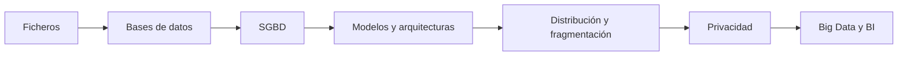

- **Pregunta guía:** ¿cómo almacenamos, protegemos y analizamos datos cuando aumentan el volumen, los usuarios y la distancia entre sistemas?
- Seguiremos la evolución desde un fichero local hasta una arquitectura analítica distribuida.

---

<!-- _class: lead -->
<!-- content: UD01-C01 -->
# Bloque 1 · Ficheros

## ¿Qué ocurre cuando cada aplicación guarda sus propios datos?

De la estructura del registro a las limitaciones que impulsan el uso de bases de datos.

---

<!-- content: UD01-C01 -->
# C01 · Ficheros: estructura básica

> **Fichero:** colección de registros, normalmente de estructura homogénea, almacenada en memoria secundaria y gestionada por una aplicación o sistema de archivos.

- **Registro:** conjunto de campos que describe una entidad concreta. Ejemplo: el cliente `11111111A`.
- **Campo:** unidad de información con nombre, tipo, dominio y, a menudo, longitud.
- **Clave:** campo o conjunto de campos que identifica un registro sin ambigüedad. Puede ser simple (`NIF`) o compuesta (`ID_PEDIDO, Nº_LINEA`).
- Operaciones: **alta**, **baja**, **modificación** y **consulta**.

| Campo | Tipo | Ejemplo | Papel |
|---|---|---|---|
| `NIF` | CHAR(9) | `11111111A` | clave |
| `APELLIDOS` | VARCHAR(40) | `Pérez Soto` | dato |
| `NACIMIENTO` | DATE | `2006-05-18` | dato |

---

# C01 · Ficheros frente a base de datos

| Ficheros tradicionales | Base de datos |
|---|---|
| Cada programa suele mantener sus propios archivos | Un SGBD gestiona datos compartidos |
| Formato y acceso acoplados al código | Esquema, vistas y lenguaje de consulta |
| Reglas repetidas en cada aplicación | Integridad, seguridad y concurrencia centralizadas |
| Consultas no previstas exigen programar | Consultas declarativas sobre datos relacionados |

**Ejemplo:** `ventas.csv` y `contabilidad.xlsx` guardan dos direcciones para el mismo cliente. Si solo se actualiza una, aparece una **inconsistencia**.

> El SGBD no elimina toda redundancia: puede existir redundancia controlada por rendimiento, disponibilidad o tolerancia a fallos.

---

# C01 · Organización secuencial

Los registros se colocan uno detrás de otro, a menudo ordenados por la clave.

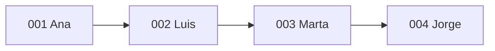

- **Lectura completa:** muy eficiente para nóminas o facturación por lotes.
- **Búsqueda puntual:** puede recorrer `N` registros; coste aproximado **O(N)**.
- Insertar en mitad del fichero puede obligar a desplazar o reescribir registros.

**Ejemplo:** para localizar la clave `004` en 10 000 registros, el peor caso exige examinar los 10 000. La estructura es simple, pero no adecuada para muchas consultas aleatorias.

---

# C01 · Organización indexada

El fichero de datos mantiene un orden y un **índice** asocia claves o rangos con posiciones o páginas.

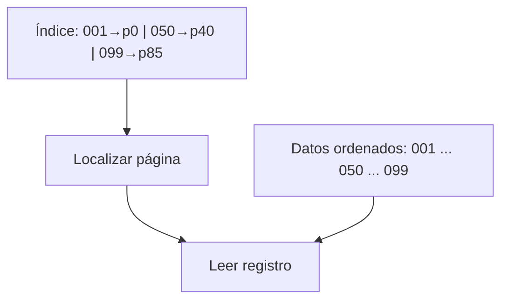

- **Índice primario:** suele construirse sobre la clave de ordenación.
- **Índice secundario:** acelera búsquedas por otros atributos, por ejemplo `APELLIDOS`.
- Estructuras frecuentes: **árboles B/B+** e **ISAM**.
- Ventaja: combina recorrido ordenado y acceso directo razonable.
- Coste: espacio adicional, mantenimiento y posibles páginas de desbordamiento.

> Un índice no es otra copia completa que sustituya a los datos: es una estructura auxiliar para encontrarlos mejor.

---

# C01 · Acceso directo mediante hash

> **Función hash:** transforma una clave en una posición de una tabla de tamaño `M`.

`h(k) = k mod M`

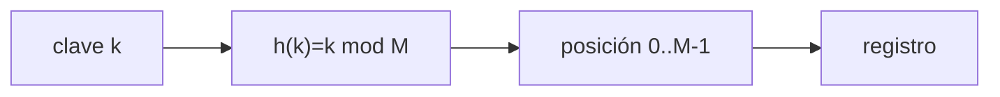

Para `M = 10`:

| Clave | Cálculo | Posición |
|---:|---:|---:|
| 34 | 34 mod 10 | 4 |
| 57 | 57 mod 10 | 7 |
| 24 | 24 mod 10 | 4 |

`34` y `24` producen una **colisión**. El coste esperado es cercano a **O(1)**, pero depende de la función, el factor de carga y la resolución de colisiones.

---

# C01 · Resolver colisiones

**Encadenamiento:** cada cubeta mantiene una lista de registros con la misma posición.

```text
posición 4 → [34, Ana] → [24, Marta] → fin
```

**Direccionamiento abierto:** todos los registros viven en la tabla; si la posición está ocupada, se prueba otra.

- **Lineal:** `h(k,i) = (h(k)+i) mod M`; sencillo, pero agrupa posiciones contiguas.
- **Cuadrático:** `h(k,i) = (h(k)+c1·i+c2·i²) mod M`; reduce agrupaciones primarias.
- **Doble hash:** `h(k,i) = (h1(k)+i·h2(k)) mod M`; usa una segunda función.

**Debate:** para claves `34, 24, 14` y `M=10`, ¿qué ocurre con sondeo lineal desde la posición 4? ¿Qué ventaja tendría el encadenamiento si la tabla se llena?

---

# C01 · Problemas clásicos de los ficheros

| Problema | Ejemplo concreto | Efecto |
|---|---|---|
| Redundancia | dirección repetida en clientes y pedidos | inconsistencia |
| Aislamiento | CSV, binario y hoja de cálculo | integrar es costoso |
| Acoplamiento físico-lógico | cambiar longitud de `NIF` rompe programas | mantenimiento difícil |
| Concurrencia | dos retiradas leen saldo 100 y guardan 70 | actualización perdida |
| Integridad | cada programa valida que el saldo sea ≥ 0 | reglas duplicadas |
| Seguridad | cualquier proceso lee el archivo completo | control fino difícil |

> Estas limitaciones explican la transición hacia una base de datos con un gestor común.

---

# ✏️ Actividad C01 · Elegir organización

Una biblioteca tiene 2 millones de libros. Cada noche genera un listado completo; durante el día consulta libros por ISBN y ocasionalmente por autor.

1. ¿Qué organización favorecerías para el listado?
2. ¿Qué índice secundario añadirías?
3. ¿Cuándo preferirías hash por ISBN?

**Puesta en común:** secuencial para el lote; índice secundario para autor; hash para accesos puntuales por ISBN si no se necesita recorrer ordenadamente. Justifica el coste de mantenimiento y las colisiones.

---

<!-- _class: lead -->
<!-- content: UD01-C02 -->
# Bloque 2 · Bases de datos

## ¿Cómo pasamos de archivos aislados a datos compartidos y controlados?

Definición, propósito, metadatos y criterios para elegir una base de datos.

---

<!-- content: UD01-C02 -->
# C02 · Concepto formal de base de datos

> Para **Date**, una base de datos es una colección de datos persistentes usada por los sistemas de aplicación de una organización.

> Para **Codd**, el modelo relacional organiza los datos como relaciones y busca independencia de los detalles físicos mediante una base matemática.

> Para **Elmasri y Navathe**, es una colección de datos relacionados con significado inherente, diseñada para satisfacer las necesidades de una organización.

**Idea común:** datos relacionados + persistencia + propósito compartido + gestión controlada.

---

# C02 · Datos, información y metadatos

| Concepto | Definición | Ejemplo |
|---|---|---|
| **Dato** | valor registrado sin interpretación completa | `125.40` |
| **Información** | datos procesados que responden una pregunta | “Ventas de marzo: 125,40 €” |
| **Metadato** | dato que describe otros datos | `importe DECIMAL(8,2) NOT NULL` |

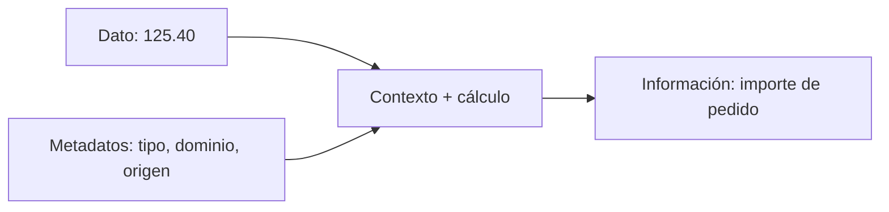

El catálogo puede saber que `NIF` es clave, `FECHA` es `DATE` y `ID_CLIENTE` referencia a `CLIENTES`.

---

# C02 · Ventajas y ciclo de vida

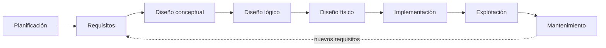

- Compartición y menor redundancia perjudicial.
- Integridad, seguridad, recuperación y concurrencia controlada.
- Independencia entre aplicaciones y almacenamiento.
- El mantenimiento incluye evolución del esquema, rendimiento, copias, migraciones y auditoría.

**Ejemplo:** añadir un índice en `FECHA_PEDIDO` es diseño físico; cambiar la relación entre pedido y cliente es diseño lógico.

---

# 💡 Actividad C02 · ¿Fichero o BD?

**Caso A:** una agenda personal con 40 contactos, un usuario y copia manual mensual.

**Caso B:** un comercio con web, almacén, facturación y aplicación móvil que comparten clientes y stock.

- Decide en cada caso y argumenta usando **volumen, usuarios, consultas, integridad y coste**.
- Identifica qué metadatos serían necesarios para `STOCK`.

**Solución orientativa:** A puede resolverse con fichero; B necesita una base de datos y control de concurrencia. No basta con contar registros: importa el uso compartido y la coherencia.

---

<!-- _class: lead -->
<!-- content: UD01-C03 -->
# Bloque 3 · Modelos de datos

## ¿Qué forma de representación encaja con cada tipo de relación?

Árboles, redes, tablas y familias NoSQL: elegir es razonar sobre datos y operaciones.

---

<!-- content: UD01-C03 -->
# C03 · Modelos de datos

> **Modelo de datos:** conceptos, reglas y notaciones para describir entidades, atributos, relaciones y operaciones sobre los datos.

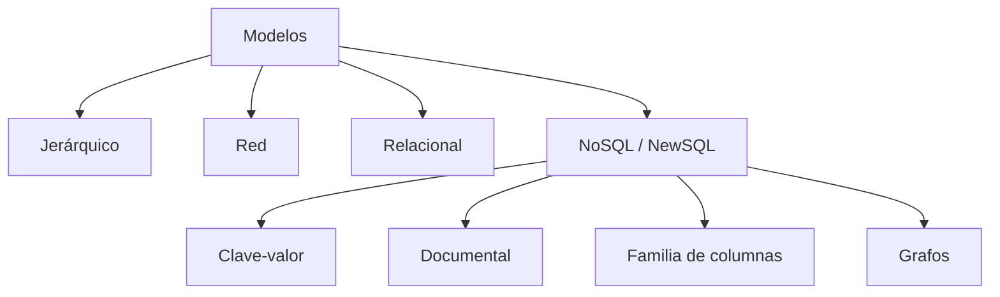

El modelo condiciona la forma de representar, consultar, escalar y garantizar las operaciones.

---

# C03 · Jerárquico y en red

**Jerárquico:** árbol con un padre por nodo y relaciones típicas `1:N`. IBM **IMS** es un ejemplo histórico.

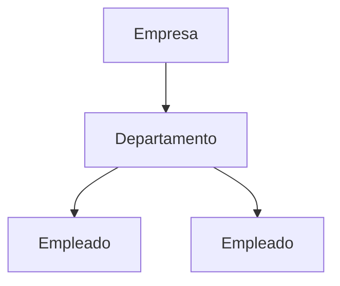

Es eficiente si la navegación siempre sigue la jerarquía, pero representa mal un alumno matriculado en varias asignaturas.

**En red:** grafo dirigido de registros conectados por enlaces; los *sets* de **CODASYL** permiten varios padres y relaciones `N:M`.

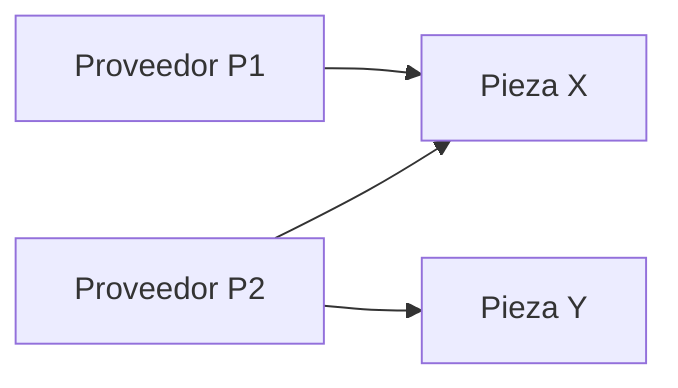

Su navegación por punteros es potente, pero acopla las consultas a la estructura física.

---

# C03 · Modelo relacional

> **Relación:** tabla; **tupla:** fila; **atributo:** columna; **clave primaria (PK):** identifica una fila; **clave foránea (FK):** referencia una PK de otra tabla.

| `CLIENTES` |  |  |
|---|---|---|
| **ID_CLIENTE (PK)** | NOMBRE | NIF |
| 1 | Ana Pérez | 11111111A |
| 2 | Luis Gómez | 22222222B |

| `PEDIDOS` |  |  |
|---:|---:|---|
| **ID_PEDIDO (PK)** | **ID_CLIENTE (FK)** | FECHA |
| 100 | 1 | 2026-01-10 |

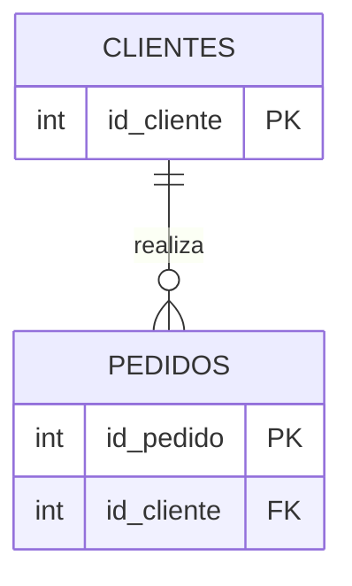

SQL es declarativo: se indica **qué** filas se necesitan, no qué punteros físicos recorrer.

---

# C03 · Familias NoSQL y NewSQL

| Modelo | Representación | Producto / caso adecuado |
|---|---|---|
| Clave-valor | `sesion:42 → {…}` | Redis: caché y sesiones |
| Documental | documentos JSON/BSON en colecciones | MongoDB: catálogo variable |
| Columnar | familias de columnas | Cassandra/HBase: eventos y series a gran escala |
| Grafo | nodos, aristas y propiedades | Neo4j: recomendaciones y rutas |

```json
{
  "id": 1,
  "nombre": "Ana Pérez",
  "preferencias": {"idioma": "es", "avisos": true}
}
```

**NewSQL** conserva transacciones y semántica relacional, pero busca escalabilidad distribuida horizontal.

---

# C03 · ¿Qué modelo elegir?

| Necesidad | Elección razonable | Motivo |
|---|---|---|
| Nóminas y transferencias | Relacional | esquema, integridad y ACID |
| Carrito temporal por usuario | Clave-valor | clave conocida y baja latencia |
| Productos con atributos variables | Documental | esquema flexible y documento agregado |
| Telemetría masiva por dispositivo | Columnar | escrituras y consultas por familias |
| “Amigos de amigos” | Grafo | relaciones explícitas navegables |

> No existe “el mejor modelo” en abstracto: se elige según patrón de acceso, consistencia, volumen, variabilidad y coste operativo.

---

# ✏️ Actividad C03 · Justifica la elección

Una plataforma combina: login, catálogo de videojuegos, recomendaciones sociales y pagos.

1. Asigna una tecnología o modelo a cada parte.
2. ¿Usarías un único SGBD? ¿Qué problema plantea cada alternativa?

**Debate:** Redis puede servir sesiones; MongoDB, catálogo; Neo4j, relaciones; un relacional, pagos. Separar sistemas aporta adecuación, pero aumenta integración, observabilidad y operación.

---

<!-- _class: lead -->
<!-- content: UD01-C04 -->
# Bloque 4 · Ubicación de la información

## ¿Dónde viven los datos y quién accede a ellos?

Centralización, cliente-servidor, arquitecturas por capas y distribución no son sinónimos.

---

<!-- content: UD01-C04 -->
# C04 · Ubicación de la información

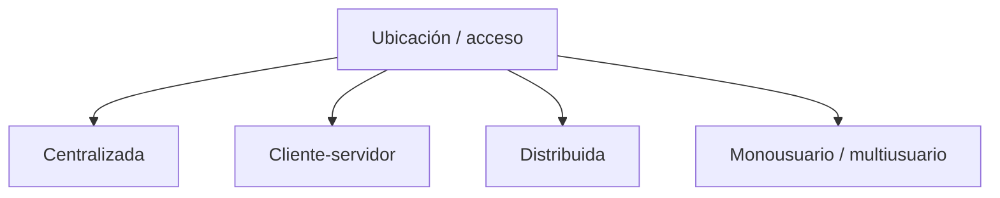

- **Centralizada:** datos y SGBD en un servidor o sistema único.
- **Cliente-servidor:** clientes solicitan servicios a un servidor; puede seguir siendo centralizada.
- **Distribuida:** datos o réplicas en nodos autónomos interconectados.
- **Monousuario/multiusuario:** clasificación por accesos simultáneos, no por ubicación.

---

# C04 · Cliente-servidor: dos y tres capas

**Dos capas:** el cliente habla directamente con el SGBD.

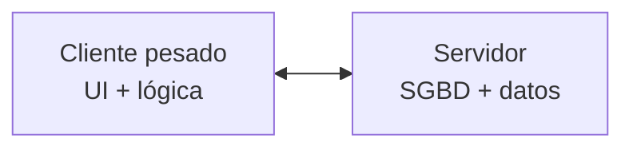

**Tres capas:** la aplicación intermedia concentra la lógica y el cliente suele ser ligero.

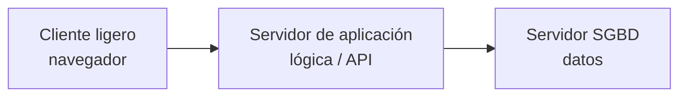

| Arquitectura | Ventaja | Riesgo |
|---|---|---|
| Centralizada | control simple | punto único de fallo |
| 2 capas | sencilla y directa | lógica dispersa en clientes |
| 3 capas | seguridad y mantenimiento centralizados | más componentes y latencia |

---

<!-- _class: lead -->
<!-- content: UD01-C05 -->
# Bloque 5 · El SGBD por dentro

## ¿Quién protege la integridad cuando muchos usuarios trabajan a la vez?

ANSI/SPARC, independencia, optimización, catálogo y transacciones ACID.

---

<!-- content: UD01-C05 -->
# C05 · Qué es un SGBD

> **SGBD/DBMS:** software que permite definir, crear, mantener y consultar una base de datos, proporcionando acceso controlado a usuarios y aplicaciones.

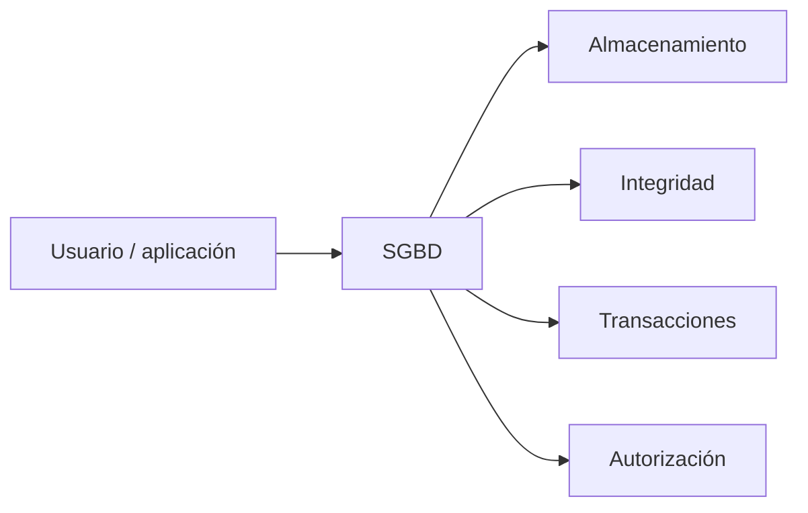

- **DDL:** define tablas, dominios, restricciones y vistas.
- **DML:** inserta, consulta, actualiza y elimina.
- **DCL:** concede y revoca privilegios.
- También gestiona concurrencia, copias, recuperación y rendimiento.

---

# C05 · ANSI/SPARC: tres niveles

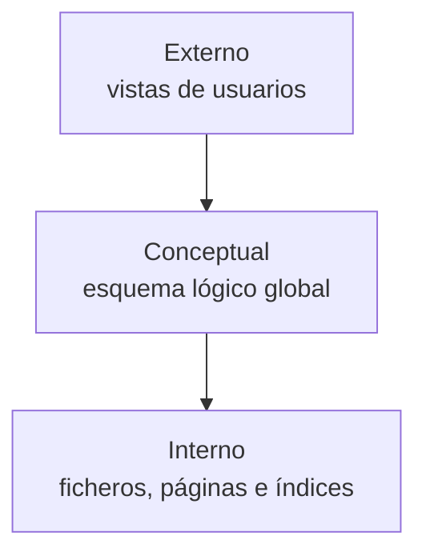

| Nivel | Pregunta | Ejemplo |
|---|---|---|
| **Externo** | ¿Qué ve cada perfil? | RR. HH. ve DNI y contrato |
| **Conceptual** | ¿Qué datos y relaciones existen? | `ALUMNOS`, `ASIGNATURAS`, `NOTAS` |
| **Interno/físico** | ¿Cómo se almacenan? | páginas, índices B+, buffer |

Una vista puede ocultar salario o combinar columnas. El esquema conceptual sigue siendo común; el interno puede cambiar sin que lo sepa la aplicación.

---

# C05 · Independencia de datos

> **Independencia física:** cambiar almacenamiento, páginas o índices sin cambiar el esquema conceptual ni las aplicaciones.

> **Independencia lógica:** cambiar el esquema conceptual sin romper vistas y programas que continúan siendo válidos.

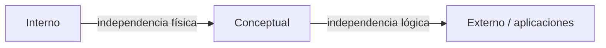

**Ejemplos:** añadir un índice sobre `FECHA` es cambio físico; añadir una entidad `PROVEEDORES` sin alterar la vista de clientes es cambio lógico.

---

# C05 · Componentes del SGBD

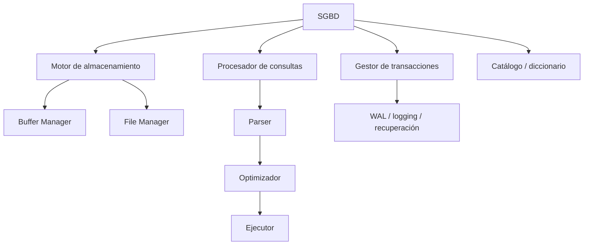

- **Buffer Manager:** mueve páginas entre disco y memoria y decide qué páginas conservar.
- **File Manager:** organiza archivos, páginas, registros e índices.
- **Parser:** comprueba sintaxis y nombres; **optimizador:** compara planes; **ejecutor:** los lleva a cabo.
- **Catálogo:** metadatos, estadísticas, restricciones, permisos e índices.

---

# C05 · Transacciones y ACID

> Una **transacción** es una unidad lógica de trabajo que debe llevar al sistema de un estado consistente a otro.

| Propiedad | Significado | Ejemplo de transferencia |
|---|---|---|
| Atomicidad | todo o nada | se resta y se suma, o ninguna |
| Consistencia | respeta restricciones | saldo y claves siguen siendo válidos |
| Aislamiento | operaciones concurrentes no se interfieren indebidamente | no leer saldo intermedio |
| Durabilidad | un commit sobrevive a un fallo | registro persistido en log |

**WAL (Write-Ahead Logging):** el cambio se registra en el log antes de confirmar la página de datos; permite rehacer o deshacer tras un corte.

---

# ✏️ Actividad C05 · Diagnóstico

Indica el componente o propiedad principal:

1. Se cambia un índice sin tocar la aplicación.
2. Dos usuarios actualizan la misma fila.
3. `SELECT` elige un índice en lugar de recorrer toda la tabla.
4. El servidor se apaga después de confirmar un pago.
5. Una vista de alumnado oculta su teléfono.

**Solución:** independencia física; concurrencia/aislamiento; optimizador; WAL/durabilidad; nivel externo y seguridad.

---

<!-- _class: lead -->
<!-- content: UD01-C06 -->
# Bloque 6 · Clasificar SGBD

## ¿Una clasificación basta para describir un gestor?

Modelo, usuarios, distribución, propósito y licencia son dimensiones combinables.

---

<!-- content: UD01-C06 -->
# C06 · Clasificar un SGBD

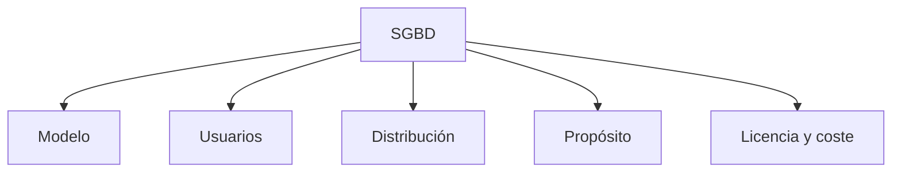

| Criterio | Categorías y ejemplos |
|---|---|
| Modelo | relacional, multi-modelo, NoSQL |
| Usuarios | monousuario, multiusuario |
| Distribución | centralizado, distribuido |
| Propósito | generalista, embebido/específico |
| Licencia | propietario/comercial, Open Source |

Un producto puede ser simultáneamente multiusuario, relacional, distribuido y comercial.

---

# C06 · Ejemplos y licencia

- **SQLite:** relacional, embebido, sin servidor separado; útil en móvil o aplicaciones locales.
- **PostgreSQL, MySQL y MariaDB:** relacionales multiusuario de código abierto, con costes posibles de operación y soporte.
- Un producto propietario puede incluir soporte oficial y funciones empresariales, pero exige revisar licencia, escalabilidad y coste total.

| “Libre” significa… | No significa necesariamente… |
|---|---|
| derechos definidos por una licencia abierta | coste operativo cero |
| posibilidad de estudiar o modificar según licencia | ausencia de soporte profesional |
| comunidad y ecosistema | que todos los productos sean equivalentes |

---

# 💡 Actividad C06 · Ficha de clasificación

Clasifica una solución que usa SQLite en el móvil y PostgreSQL en el servidor:

- ¿Es monousuario o multiusuario cada componente?
- ¿Es embebido o generalista?
- ¿Puede el sistema completo ser híbrido?

**Punto de debate:** las clasificaciones describen dimensiones diferentes. SQLite no deja de ser relacional por ser embebido; PostgreSQL no deja de ser Open Source por admitir soporte comercial.

---

<!-- _class: lead -->
<!-- content: UD01-C07 -->
# Bloque 7 · Bases distribuidas

## ¿Cómo mantenemos una decisión común cuando los nodos están separados?

Replicación, 2PC, fallos, CAP y PACELC muestran el coste de distribuir.

---

<!-- content: UD01-C07 -->
# C07 · Centralizada frente a distribuida

> **BD distribuida:** conjunto de datos repartidos en nodos autónomos conectados por red que se presenta lógicamente como una base de datos común.

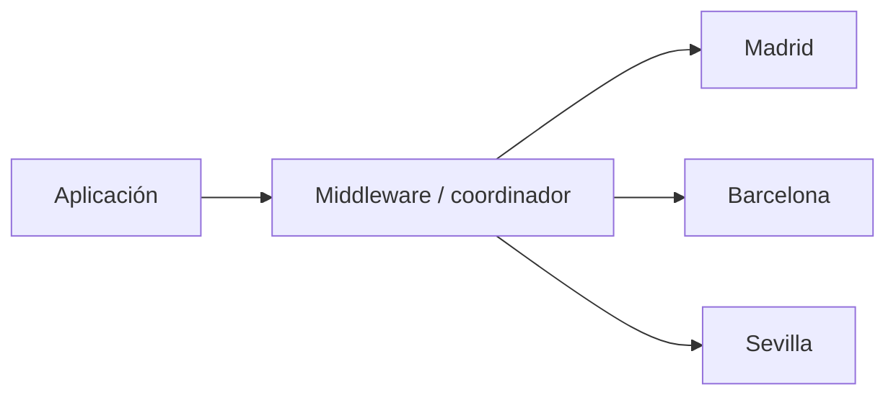

| Centralizada | Distribuida |
|---|---|
| administración y consistencia directas | escala horizontal y autonomía local |
| posible cuello de botella | tolerancia a fallos y cercanía geográfica |
| punto único de fallo | latencia, coste y coordinación |

---

# C07 · Por qué distribuir

**Ventajas:**

- Añadir nodos permite **escalabilidad horizontal**.
- Una réplica puede mantener el servicio ante la caída de otra.
- Una sede consulta datos próximos y reduce latencia.
- Cada nodo puede conservar cierta autonomía local.

**Desventajas:**

- Fallos de red y relojes dificultan saber el estado real.
- Aumentan latencia, coste de comunicaciones y complejidad operativa.
- Las transacciones multi-nodo y la concurrencia distribuida requieren coordinación.
- Las réplicas pueden mostrar temporalmente valores distintos.

---

# C07 · Transacción distribuida y 2PC

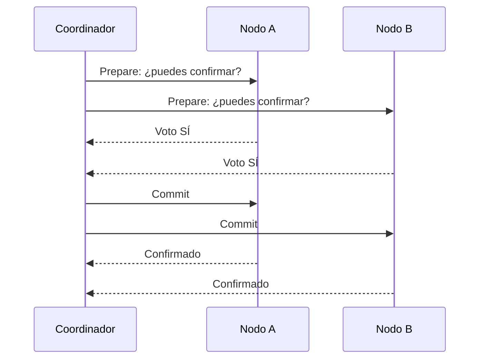

1. **Fase 1 — Prepare/voto:** cada participante valida, bloquea o prepara y responde sí/no.
2. **Fase 2 — decisión:** todos sí → `commit`; algún no o timeout → `abort/rollback`.

Garantiza una decisión común, pero puede bloquear participantes si el coordinador falla tras el voto.

---

# C07 · CAP, consistencia eventual y PACELC

```mermaid
flowchart TD
    CAP["CAP"] --> C["C: consistencia"]
    CAP --> A["A: disponibilidad"]
    CAP --> P["P: tolerancia a particiones"]
```

- Ante una partición de red no se pueden garantizar a la vez **C**, **A** y **P**: en la práctica se elige CP o AP.
- **Consistencia eventual:** si dejan de llegar cambios, todas las réplicas convergen finalmente; durante la convergencia puede haber lecturas antiguas.
- **PACELC:** si hay **P**, se elige entre disponibilidad (**A**) y consistencia (**C**); **Else**, sin partición, se elige entre baja latencia (**L**) y consistencia (**C**).

**Ejemplo:** un “like” puede tolerar convergencia eventual; el saldo bancario exige controles mucho más estrictos.

---

# ✏️ Caso C07 · Cadena de tiendas

Cada tienda debe vender aunque se corte la conexión con la central.

1. ¿Qué datos fragmentarías por tienda?
2. ¿Qué datos replicarías?
3. Durante la partición, ¿qué operaciones serían AP y cuáles CP?

**Debate:** catálogo local y registro de pedidos pueden priorizar disponibilidad; stock global y pagos requieren evitar dobles ventas. Al restablecerse la red hay que reconciliar cambios y registrar conflictos.

---

<!-- _class: lead -->
<!-- content: UD01-C08 -->
# Bloque 8 · Fragmentación

## ¿Cómo repartimos una tabla sin perder la posibilidad de reconstruirla?

Filas, columnas o ambas: cada decisión debe cumplir reglas formales.

---

<!-- content: UD01-C08 -->
# C08 · Fragmentación de datos

> **Fragmentación:** división de una relación en fragmentos que pueden almacenarse cerca de sus usuarios, reduciendo transferencias y mejorando autonomía.

```mermaid
flowchart TD
    T["EMPLEADOS completa"] --> H["Horizontal: filas"]
    T --> V["Vertical: columnas"]
    H --> M["Mixta"]
    V --> M
```

Una fragmentación correcta cumple:

1. **Completitud:** ningún dato original se pierde.
2. **Reconstrucción:** se recupera la relación original.
3. **Disyunción:** en horizontal, una tupla no aparece repetida sin control.

---

# C08 · Horizontal primaria: selección

Tabla `EMPLEADOS(ID, NOMBRE, SEDE, SALARIO)`:

| ID | NOMBRE | SEDE | SALARIO |
|---:|---|---|---:|
| 1 | Ana | Madrid | 2200 |
| 2 | Luis | Sevilla | 2100 |
| 3 | Marta | Madrid | 2300 |
| 4 | Jorge | Sevilla | 1900 |

```text
F_M = σ(SEDE = 'Madrid')(EMPLEADOS)
F_S = σ(SEDE = 'Sevilla')(EMPLEADOS)
EMPLEADOS = F_M ∪ F_S
```

Cada fragmento conserva todas las columnas, pero solo algunas filas. Las condiciones deben cubrir todos los casos y no solaparse.

---

# C08 · Horizontal derivada

`PEDIDOS` no tiene `SEDE`, pero sí `ID_CLIENTE`; `CLIENTES` ya está fragmentada por sede.

```mermaid
flowchart LR
    C["CLIENTES\nF_Madrid"] -->|semijoin por ID_CLIENTE| P["PEDIDOS_Madrid"]
    C2["CLIENTES\nF_Sevilla"] -->|semijoin por ID_CLIENTE| P2["PEDIDOS_Sevilla"]
```

```text
PEDIDOS_M = PEDIDOS ⋉ CLIENTES_M
PEDIDOS_S = PEDIDOS ⋉ CLIENTES_S
```

La **horizontal derivada** usa la fragmentación de una relación relacionada, normalmente mediante una clave foránea y un **semijoin** `⋉`.

---

# C08 · Fragmentación vertical: proyección

```text
V1 = π(ID, NOMBRE, SEDE)(EMPLEADOS)
V2 = π(ID, SALARIO)(EMPLEADOS)
EMPLEADOS = V1 ⋈ V2  -- unión por ID
```

| `V1`: datos operativos |  |  |
|---:|---|---|
| **ID** | NOMBRE | SEDE |
| 1 | Ana | Madrid |

| `V2`: datos salariales |  |
|---:|---:|
| **ID** | SALARIO |
| 1 | 2200 |

> La clave primaria debe aparecer en **todos** los fragmentos verticales. En vertical sí se repite la clave: es lo que permite reconstruir mediante `⋈`.

---

# C08 · Fragmentación híbrida y verificación

```mermaid
flowchart TD
    T["EMPLEADOS"] --> M["σ SEDE='Madrid'"]
    T --> S["σ SEDE='Sevilla'"]
    M --> M1["π(ID,NOMBRE,SEDE)"]
    M --> M2["π(ID,SALARIO)"]
    S --> S1["π(ID,NOMBRE,SEDE)"]
    S --> S2["π(ID,SALARIO)"]
```

**Checklist:**

- ¿Aparecen todos los empleados? → completitud.
- ¿`⋃` o `⋈` recupera exactamente la tabla? → reconstrucción.
- ¿Una fila horizontal cae en un solo nodo? → disyunción.
- ¿Cada fragmento vertical conserva `ID`? → reconstrucción posible.

---

# ✏️ Actividad C08 · Detecta el error

Se definen `F1 = σ(SEDE='Madrid')` y `F2 = σ(SEDE<>'Madrid')`, pero un registro tiene `SEDE = NULL`.

1. ¿Se cumple la completitud?
2. ¿Cómo corregirías la condición?
3. En una fragmentación vertical `(ID,NOMBRE)` y `(SALARIO)`, ¿qué se ha olvidado?

**Solución:** `NULL` puede quedar fuera; debe tratarse explícitamente o definirse un fragmento para sede desconocida. Falta conservar `ID` en el segundo fragmento.

---

<!-- _class: lead -->
<!-- content: UD01-C09 -->
# Bloque 9 · Protección de datos

## ¿Qué significa diseñar una base de datos responsable?

RGPD, LOPDGDD, derechos y medidas técnicas convierten la privacidad en un requisito de diseño.

---

<!-- content: UD01-C09 -->
# C09 · Marco legal

```mermaid
flowchart TD
    R["RGPD\nReglamento UE 2016/679"] --> L["LOPDGDD\nLey Orgánica 3/2018"]
    L --> O["Diseño y operación\nde tratamientos"]
    O --> A["AEPD\nautoridad de control"]
```

- **RGPD:** norma europea directamente aplicable.
- **LOPDGDD:** adapta y desarrolla el marco español y los derechos digitales.
- Se protege a la persona identificada o identificable; la organización debe poder demostrar cumplimiento (**accountability**).

---

# C09 · Principios RGPD con ejemplos

| Principio | Aplicación en una tabla de clientes |
|---|---|
| Licitud, lealtad, transparencia | informar finalidad y base legal antes de recoger |
| Limitación de finalidad | no reutilizar el teléfono para publicidad sin base adecuada |
| Minimización | no guardar fecha de nacimiento si no es necesaria |
| Exactitud | permitir corregir una dirección |
| Limitación del plazo | definir retención y borrado |
| Integridad y confidencialidad | roles, cifrado, copias y control de accesos |
| Responsabilidad proactiva | conservar evidencias, análisis y registros |

**Caso:** una app pide DNI, ubicación permanente y fecha de nacimiento para enviar un cupón. Pregunta: ¿qué campos son necesarios y qué información debe recibir la persona?

---

# C09 · Roles y autoridad

```mermaid
flowchart LR
    R["Responsable\ndecide fines y medios"] --> E["Encargado\nactúa por instrucciones"]
    R --> D["DPO\nsupervisa y asesora"]
    I["Interesado"] --> H["Derechos"]
    A["AEPD\nautoridad de control"] --> R
```

- **Responsable:** decide para qué y cómo se tratan los datos.
- **Encargado:** presta un servicio y trata datos por cuenta del responsable, según contrato/instrucciones.
- **DPO/DPD:** asesora y supervisa cuando procede su designación obligatoria.
- **AEPD:** autoridad española de control.

**Ejemplo:** una academia decide usar datos del alumnado; su proveedor cloud puede ser encargado, no responsable de las finalidades de la academia.

---

# C09 · Derechos ARSULPO / ARCO+

```mermaid
flowchart LR
    I["Interesado"] --> A["Acceso"]
    I --> R["Rectificación"]
    I --> S["Supresión / olvido"]
    I --> U["Limitación"]
    I --> L["Portabilidad"]
    I --> O["Oposición"]
    I --> N["No decisiones automatizadas"]
```

- **Acceso:** qué datos y finalidades.
- **Rectificación:** corregir inexactitudes.
- **Supresión:** borrar cuando proceda; no es absoluto si existe obligación legal de conservar.
- **Limitación/oposición:** restringir o rechazar ciertos tratamientos.
- **Portabilidad:** recibir datos en formato estructurado.
- Derecho a no quedar sujeto a determinadas decisiones exclusivamente automatizadas con efectos relevantes, con las garantías aplicables.

---

# C09 · Privacidad desde el diseño

- **Por defecto:** recoger la configuración menos invasiva.
- **Cifrado:** protege datos en tránsito y reposo; gestionar claves correctamente.
- **Seudonimización:** sustituir identificadores directos por códigos; no equivale a anonimización irreversible.
- **RAT:** registro de actividades de tratamiento: finalidad, categorías, destinatarios, conservación y medidas.
- Roles mínimos, vistas, MFA, auditoría, copias y pruebas de restauración.

**Diseño concreto:** separar `ALUMNO(ID, nombre)` de `CONTACTO(ID, email)`, restringir la segunda tabla a tutoría y registrar accesos. Esto reduce exposición, pero no elimina las obligaciones legales.

---

# 💡 Actividad C09 · Responder una solicitud

Una persona pide acceso, rectificación de su email y supresión de su cuenta. Sin embargo, existe una factura que la organización debe conservar por obligación legal.

1. ¿Qué tablas y sistemas hay que localizar?
2. ¿Qué se rectifica y qué se suprime?
3. ¿Qué evidencia guardarías en el RAT o sistema de solicitudes?

**Debate:** localizar todos los tratamientos, verificar identidad, responder dentro de plazo y conservar solo lo exigido; documentar la excepción al borrado de la factura.

---

<!-- _class: lead -->
<!-- content: UD01-C10 -->
# Bloque 10 · Big Data y BI

## ¿Cómo convertimos datos diversos y veloces en decisiones útiles?

Las 5 V, OLTP/OLAP, ETL/ELT y las arquitecturas analíticas conectan almacenamiento y valor.

---

<!-- content: UD01-C10 -->
# C10 · Big Data y sus 5 V

> **Big Data:** datos cuyo volumen, velocidad, variedad, veracidad o necesidad de análisis hacen insuficientes los enfoques tradicionales para capturarlos, almacenarlos y procesarlos con eficacia.

```mermaid
flowchart TD
    B["Big Data"] --> V["Volumen\nTB/PB de eventos"]
    B --> S["Velocidad\neventos por segundo"]
    B --> R["Variedad\ntablas, JSON, vídeo"]
    B --> Q["Veracidad\ncalidad y sesgo"]
    B --> VAL["Valor\ndecisión útil"]
```

**Ejemplos:** sensores de una flota aportan velocidad y volumen; vídeos aportan variedad; datos duplicados reducen veracidad; una alerta de fraude convierte el análisis en valor.

---

# C10 · OLTP frente a OLAP

| OLTP | OLAP |
|---|---|
| operaciones del día a día | análisis histórico |
| muchas escrituras cortas y atómicas | lecturas masivas y agregaciones |
| esquema normalizado | modelo dimensional/desnormalizado frecuente |
| baja latencia por transacción | consultas más largas |
| pedido, pago, stock | ventas por región y trimestre |

```mermaid
flowchart LR
    O["OLTP\nPedido 1042"] --> E["ETL/ELT"] --> W["DWH / Data Mart"] --> A["OLAP\nventas por mes"]
```

**BI:** conjunto de procesos, herramientas y prácticas que convierten datos en informes, indicadores, alertas y decisiones.

---

# C10 · ETL y ELT con ejemplo

```mermaid
flowchart LR
    S["ERP + CRM + JSON"] --> E["Extraer"]
    E --> T["Transformar"] --> L["Cargar DWH"]
    E --> R["Cargar datos crudos"] --> T2["Transformar en destino"]
```

- **ETL:** extraer → validar/limpiar → transformar → cargar. Predomina en almacenes con esquema rígido.
- **ELT:** extraer → cargar en bruto → transformar cuando se consulta o prepara. Aprovecha almacenamiento/cómputo escalable.

**Ejemplo:** convertir `12,50 €`, `12.50` y `12,5` a `DECIMAL(10,2)` es transformación; conservar el JSON original permite reprocesar con otra regla.

---

# C10 · Data Warehouse, Lake y Lakehouse

| Plataforma | Esquema | Datos | Uso |
|---|---|---|---|
| **Data Warehouse** | schema-on-write | estructurados y modelados | KPIs oficiales |
| **Data Lake** | schema-on-read | crudos: tablas, JSON, vídeo | exploración y ML |
| **Lakehouse** | flexible + gobierno | objetos con capas ACID | combinar apertura y fiabilidad |

```mermaid
flowchart LR
    F["ERP · CRM · sensores"] --> W["Warehouse\nestructurado"]
    F --> L["Lake\nbruto"]
    L --> H["Lakehouse\ncapas ACID + catálogo"]
    W --> BI["Dashboards BI"]
    H --> BI
```

**Escenario:** una empresa guarda ventas SQL, eventos JSON y vídeos de cámaras. Lake/Lakehouse conserva variedad; el Warehouse publica un modelo fiable para dirección.

---

# C10 · Lambda y Kappa

**Lambda:** dos caminos para el mismo dominio de eventos.

```mermaid
flowchart LR
    S["Eventos"] --> B["Batch\nhistórico completo"] --> V["Serving"]
    S --> SP["Speed\nstreaming"] --> V
    V --> Q["Consultas y alertas"]
```

- Batch corrige y recalcula; speed ofrece baja latencia; serving combina vistas.
- Potente, pero duplica lógica y puede producir resultados difíciles de reconciliar.

**Kappa:** un log de eventos y un único procesamiento streaming; para corregir, se reprocesa el historial.

**Caso:** detección de fraude casi inmediata + informe diario. Lambda facilita ambos ritmos; Kappa simplifica el código si el motor de streaming y el reproceso son suficientes.

---

# ✏️ Actividad C10 · Arquitectura analítica

Una plataforma recibe 50 000 eventos/minuto, ventas relacionales, reseñas JSON y quiere:

- alerta de fraude en menos de 5 segundos;
- informe mensual por producto y país;
- conservar datos para nuevas preguntas.

Decide: 5 V, OLTP/OLAP, ETL/ELT, Lake/Warehouse/Lakehouse y Lambda/Kappa.

**Solución orientativa:** velocidad, volumen y variedad; OLTP separado de OLAP; ELT conserva crudos; Lakehouse + Warehouse publicado; streaming para fraude y batch para cierres, o Kappa si se acepta reprocesar el log.

---

<!-- _class: lead -->
<!-- content: UD01-C01, UD01-C02, UD01-C03, UD01-C04, UD01-C05, UD01-C06, UD01-C07, UD01-C08, UD01-C09, UD01-C10 -->
# Síntesis y cierre

## Del fichero local a la decisión informada

Integraremos organización, modelos, gestión, distribución, privacidad y análisis.

---

# Síntesis: del dato a la decisión

```mermaid
flowchart LR
    F["Ficheros\nO(N), redundancia"] --> B["BD\nmodelo y relaciones"]
    B --> S["SGBD\nACID, seguridad, independencia"]
    S --> D["Distribución\n2PC, CAP, fragmentación"]
    D --> P["RGPD\nminimización y derechos"]
    P --> BI["Big Data / BI\nvalor y decisiones"]
```

- Elegir una organización de fichero depende del patrón de acceso.
- Una BD es distinta del software que la gestiona: **datos ≠ SGBD**.
- El modelo, la ubicación y la fragmentación tienen consecuencias técnicas.
- Distribuir aporta escala, pero obliga a tratar latencia, fallos y consistencia.
- La privacidad debe formar parte del diseño, no añadirse al final.
- Big Data solo tiene sentido si produce información útil y decisiones mejores.

---

# Ideas clave · comprobación final

1. Calcula `h(k)=k mod 10` para `34, 24, 57` y explica dos resoluciones de colisión.
2. Diferencia dato, información y metadato con un ejemplo.
3. ¿Qué separa el nivel externo del conceptual? ¿Y la independencia física de la lógica?
4. Elige modelo para una sesión, un catálogo variable y una red social.
5. ¿Qué ocurre en las dos fases de 2PC? ¿Qué compromiso plantea CAP?
6. Fragmenta `EMPLEADOS` horizontal y verticalmente: ¿cómo reconstruyes?
7. Explica responsable, encargado y DPO con un escenario cloud.
8. Distingue OLTP/OLAP, ETL/ELT y Lambda/Kappa.

> Si puedes responder con un caso concreto, has conectado almacenamiento, gestión, distribución, privacidad y análisis.
