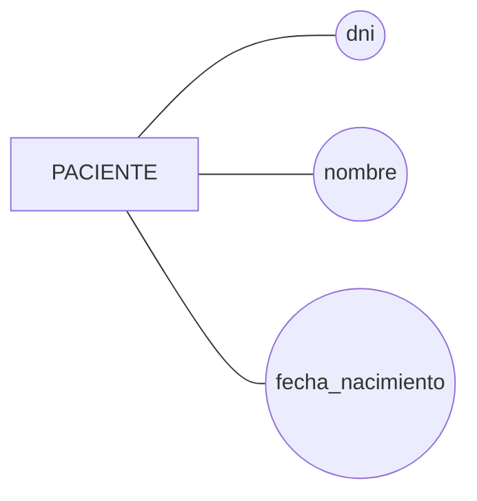
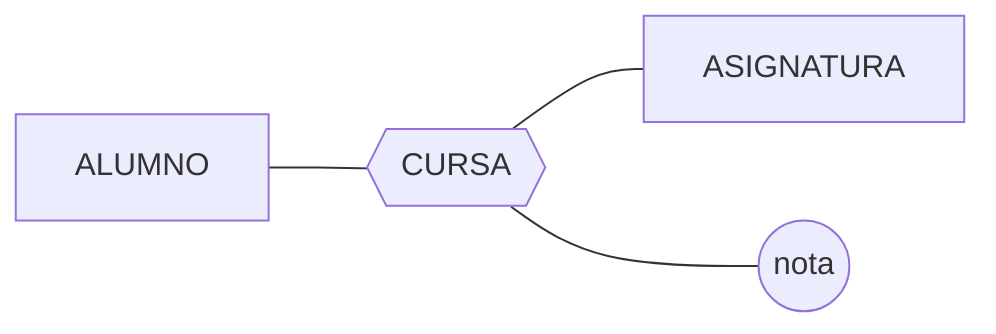
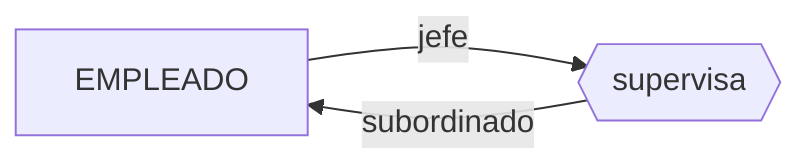
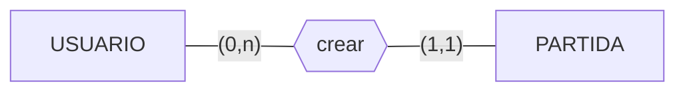
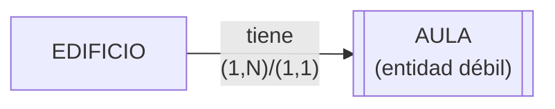
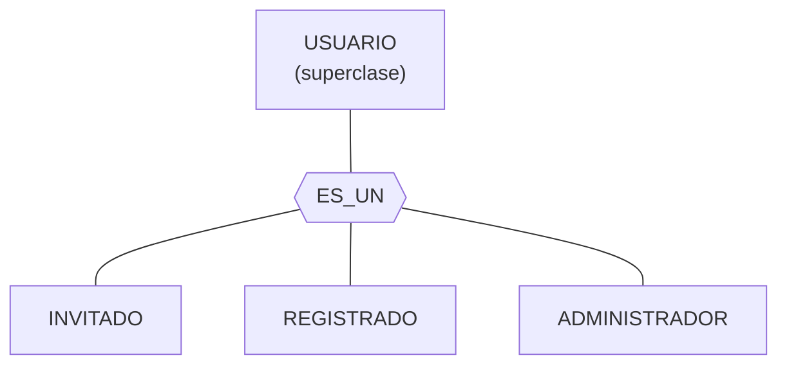
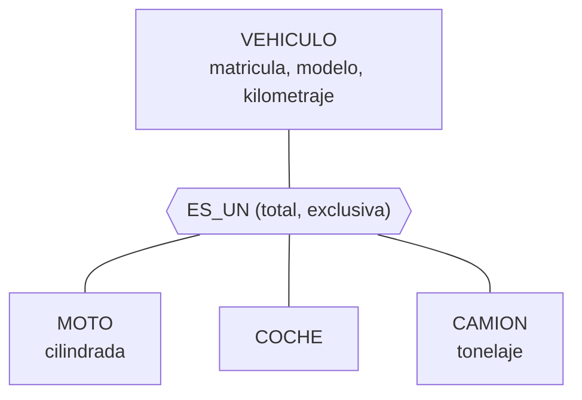
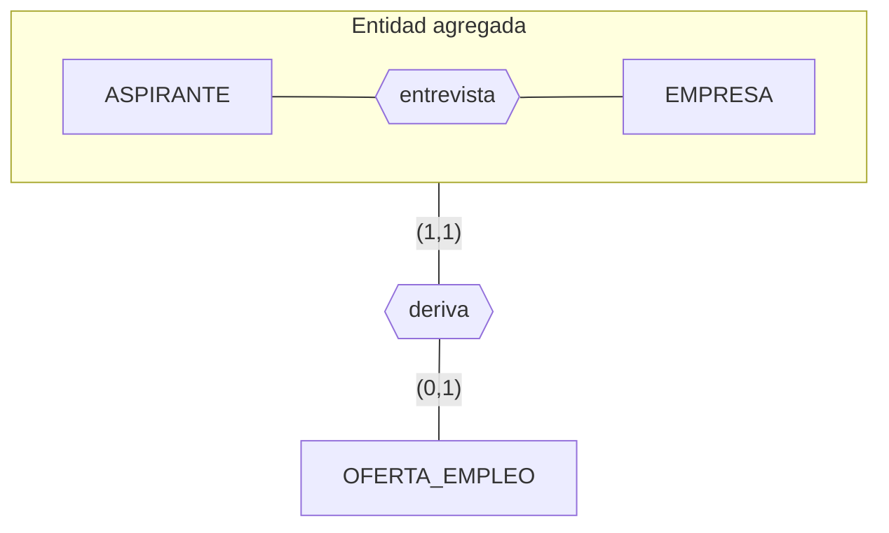
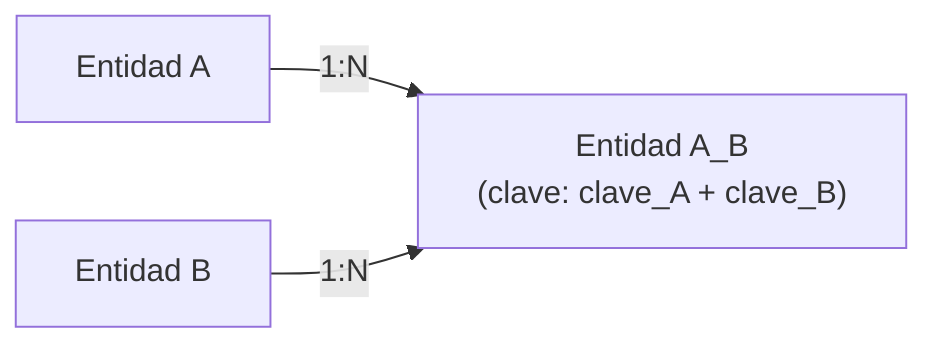
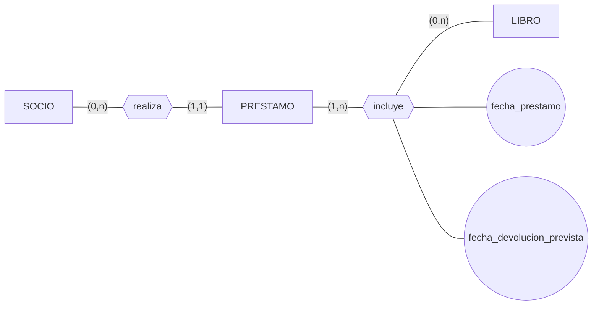

<!-- content: UD02-C01 -->

# UD02. El modelo Entidad/Relación

Diseño conceptual de bases de datos

---

# ¿Qué vamos a estudiar?

Antes de construir una base de datos hay que comprender **qué información almacenar**, **cómo se relaciona** y **qué restricciones debe cumplir**.

A esta fase se la llama **diseño conceptual**, y su herramienta de referencia es el **modelo Entidad/Relación (E/R)**, propuesto por **Peter Chen (1976)**.

- Elementos básicos: entidades, atributos, relaciones.
- Cardinalidades.
- Debilidad de entidades.
- Modelo E/R Extendido.
- Paso del diagrama E/R al modelo relacional.
- Restricciones semánticas.
- Normalización.

---

# Análisis vs. Diseño

El desarrollo de una base de datos distingue dos fases:

| Fase de Análisis | Fase de Diseño |
|---|---|
| Localizar y definir entidades y atributos | Diseño de tablas |
| Definir relaciones entre entidades | Normalización |
| Obtención del esquema conceptual (E/R) | Aplicación del enfoque relacional |
| Fusión de vistas | Diseño de transacciones y sendas de acceso |

> El **esquema conceptual** debe reflejar **todos** los aspectos relevantes del problema real: omitir esta fase provoca pérdida de información.

---

# El modelo E/R: definición

> Herramienta de referencia para la **representación conceptual** de problemas del mundo real, que permite especificar la estructura lógica de una base de datos a partir del **documento de especificación de requerimientos**.

Características:

- Es un **modelo semántico**: representa significado, no formato físico.
- **Independiente** de cualquier SGBD o tecnología concreta.
- Puede describir tanto sistemas informatizados como procesos manuales.
- Se basa en dos objetos fundamentales: **entidades** y **relaciones**.

---

# El modelo E/R en el proceso de diseño


El diagrama E/R es el **punto de partida**: hasta que no se implementa en un SGBD, el diseño es independiente de la tecnología.

Con el tiempo evolucionó al **modelo E/R Extendido (ERE)**, que añade mecanismos para situaciones que el modelo básico no cubre con precisión.

---

<!-- content: UD02-C02 -->

# Entidades

> **Entidad**: objeto real o abstracto, con características diferenciadoras que permiten distinguirlo de otros objetos.

- Objeto físico y concreto: un cliente, un vehículo.
- Concepto abstracto: un préstamo, una reserva.

Un **conjunto de entidades** agrupa entidades con las mismas características (p. ej. `CLIENTE`). Cada elemento concreto es una **ocurrencia**.

> Analogía POO: entidad ≈ instancia de un objeto; conjunto de entidades ≈ clase.

**Representación**: rectángulo con el nombre en mayúsculas, en singular.


---

# Atributos

> **Atributo**: propiedad o característica de una entidad o relación. Toma valores de un **dominio** (conjunto de valores permitidos).

**Representación**: elipse con el nombre en minúscula, conectada a la entidad.



Varios atributos pueden compartir dominio (p. ej. `nombre`, `apellido_1` y `apellido_2` comparten el dominio de cadenas de caracteres).

---

# Tipos de atributos

| Clasificación | Valores | Ejemplo |
|---|---|---|
| Obligatorio / opcional | Siempre definido / puede faltar | Toda clave es obligatoria |
| Atómico / compuesto | No divisible / con subatributos | `dni` / `dirección` = calle + número + localidad |
| Monovaluado / multivaluado | Un valor / varios valores | `dni` / varios `e_mail` |
| Derivado / almacenado | Se calcula / se guarda | `edad` (a partir de `fecha_nacimiento`) |

Los atributos **multivaluados** definen su cardinalidad `(mínimo, máximo)`:

- Mínimo: `0` (opcional) o `1` (al menos uno).
- Máximo: `1` (único valor) o `n` (varios).

Ejemplo: `e_mail (0,n)` — un empleado puede no tener correo o tener varios.

---

# Claves

Identificar unívocamente cada ocurrencia de una entidad es fundamental.

| Concepto | Definición |
|---|---|
| **Superclave** | Conjunto de atributos que identifica de forma única (puede tener redundancia) |
| **Clave candidata** | Superclave mínima: no se puede quitar ningún atributo sin perder la unicidad |
| **Clave primaria (PK)** | Clave candidata elegida por el diseñador. No admite `NULL` |
| **Clave alternativa** | Resto de claves candidatas no elegidas |

**Ejemplo.** `TRABAJADOR (nombre, apellido_1, apellido_2, dni, num_afiliacion_ss, fecha_nacimiento, codigo_empresa)`

- `dni` y `num_afiliacion_ss` son claves candidatas válidas.
- Si se elige `dni` como PK, `num_afiliacion_ss` queda como clave alternativa.
- `{nombre, apellido_1, apellido_2}` **no** es clave candidata (puede repetirse).

---

# Relaciones

> **Relación**: asociación entre diferentes entidades. En una relación no pueden aparecer dos veces relacionadas las mismas ocurrencias.

**Representación**: rombo conectado mediante líneas a las entidades que asocia.

- Relación: **verbo** en singular (forman, imparte, contrata...).
- Entidad: **sustantivo** en singular.



Las relaciones también pueden tener **atributos propios**: `nota` solo tiene sentido asociada al hecho de que un alumno curse una asignatura concreta.

---

# Grado de una relación

> **Grado**: número de entidades que participan en la relación.

| Grado | Nombre | Descripción |
|---|---|---|
| 1 | Unaria (reflexiva/recursiva) | Una entidad relacionada consigo misma |
| 2 | Binaria | La más habitual |
| 3 | Ternaria | Tres entidades simultáneamente |
| n | N-aria | Poco usual; se recomienda simplificar |

**Ejemplo unario**: `supervisa` entre ocurrencias de `EMPLEADO` (rol jefe / rol subordinado).



---

<!-- content: UD02-C03 -->

# Cardinalidad de la relación

> Número **máximo** de ocurrencias de cada entidad que pueden intervenir en una ocurrencia de relación (se expresa para relaciones binarias).

| Tipo | Descripción | Ejemplo |
|---|---|---|
| **1:1** | Como mucho una ocurrencia en cada lado | `ALUMNO` – `EXPEDIENTE` |
| **1:N** | Una de A con varias de B | `DOCENTE` – `ASIGNATURA` |
| **N:1** | Lectura inversa de 1:N | `JUGADOR` – `EQUIPO` |
| **M:N** | Varias de A con varias de B | `ALUMNO` – `ASIGNATURA` (vía `CURSA`) |


> Existen otras notaciones (Chen, pata de cuervo, Bachman); en esta unidad se emplea la etiqueta explícita `1:1`, `1:N`, `N:1`, `M:N`.

---

# Cardinalidad de participación de la entidad

> Indica, para cada ejemplar de una entidad, el número **mínimo y máximo** de ocurrencias de la relación en las que puede tomar parte.

Se representa como `(mínimo, máximo)` situado **junto a la entidad opuesta**:

- Mínimo: `0` (participación opcional) o `1` (obligatoria).
- Máximo: `1` (como mucho una vez) o `n` (varias veces).


Un `JUGADOR` participa como mínimo en 0 y como máximo en 1 relación → `(0,1)` se coloca junto a `EQUIPO`.
Un `EQUIPO` participa como mínimo en 1 y como máximo en n → `(1,n)` se coloca junto a `JUGADOR`.

---

# Ejemplo: cardinalidad de participación

**Enunciado.** Un usuario registrado puede crear las partidas que desee (o ninguna); una partida solo puede haber sido creada por un único usuario.



- Cada `PARTIDA` exige exactamente un usuario creador → `(1,1)` junto a `USUARIO`.
- Cada `USUARIO` puede crear cero o varias partidas → `(0,n)` junto a `PARTIDA`.

---

<!-- content: UD02-C04 -->

# Entidades fuertes y débiles

**Entidad fuerte (regular)**: tiene existencia por sí misma; no depende de otra entidad.

**Entidad débil**: su existencia depende de otra entidad (la **entidad fuerte**), y sus atributos propios **no bastan** para identificarla completamente. Se representa con **rectángulo doble**.

**Ejemplo.** `EDIFICIO` y `AULA`: puede haber aulas con la misma numeración en edificios distintos, por lo que el número de aula no identifica de forma unívoca sin conocer también el edificio.



---

# Tipos de dependencia de una entidad débil

| Tipo | Descripción | Marca |
|---|---|---|
| **En existencia** | Si desaparece la entidad fuerte, desaparecen sus ocurrencias débiles asociadas | **E** |
| **En identificación** | Además de depender en existencia, no puede identificarse por sí misma: necesita la clave de la entidad fuerte | **ID** |

> Toda dependencia en identificación implica dependencia en existencia, pero no al revés.

**Ejemplo.** Un `FAMILIAR` a cargo puede requerir que exista el `PACIENTE` titular (dependencia en existencia), pero si tiene su propio DNI se identifica por sí mismo (sin dependencia en identificación).

**Comprobación.** ¿Cuál no podría considerarse débil: `PROVEEDOR`, `PAGO`, `FAMILIAR`? → `PROVEEDOR`, porque existe por sí mismo y su CIF lo identifica sin necesitar otra entidad.

---

# Debilidad de entidades: síntesis

1. Una entidad es **débil** cuando sus atributos no bastan para identificar sin ambigüedad cada ocurrencia.
2. Debe participar en una relación con una entidad **fuerte** que complete su identificación.
3. Dos grados: **en existencia (E)** y **en identificación (ID)**, siendo ID más restrictiva.
4. Gráficamente: **rectángulo doble**; la relación se marca con **E** o **ID**.

> Esta distinción es determinante en el **paso al modelo relacional**: toda entidad débil hereda en su tabla la clave primaria de la entidad fuerte —como parte de su propia PK si la dependencia es en identificación, o como clave foránea si es solo en existencia.

---

<!-- content: UD02-C05 -->

# El modelo E/R Extendido (ERE)

El modelo básico resulta insuficiente para representar con precisión ciertas situaciones. El **ERE** incorpora tres extensiones:

1. **Restricciones sobre las relaciones.**
2. **Generalización y especialización** (jerarquías).
3. **Agregación.**

---

# Restricciones sobre relaciones

Se aplican cuando una entidad participa en **varias relaciones simultáneas**.

| Restricción | Descripción | Ejemplo |
|---|---|---|
| **Exclusividad** | Una ocurrencia solo participa en una de las relaciones, nunca en ambas | Un `MUSICO` *dirige* o *toca*, no ambas |
| **Exclusión** | Las ocurrencias solo se asocian mediante una única relación cada vez | Un monitor *imparte* o *recibe* un curso, no ambas para el mismo curso |
| **Inclusividad** | Para asociarse mediante una relación, deben haber estado asociadas antes mediante otra | Recibir cursos previos antes de poder impartir |
| **Inclusión** | Más fuerte: debe ser exactamente la misma ocurrencia | Un hombre solo se divorcia de la misma mujer con la que se casó |

**Comprobación.** *"Para divorciarse de una mujer, primero ha de haber estado casado con ella"* → restricción de **inclusión** (misma ocurrencia exacta).

---

# Generalización y especialización

Cuando varios conjuntos de entidades comparten **atributos comunes** además de tener atributos propios diferenciadores:

- **Superclase (supertipo)**: agrupa las características comunes.
- **Subclase (subtipo)**: características específicas.
- **Generalización**: reunir subclases en una superclase.
- **Especialización**: dividir una superclase en subclases.
- **Herencia**: la subclase hereda atributos y relaciones de la superclase.

Notación **ES_UN** (IS_A): triángulo invertido, superclase arriba, subclases conectadas debajo.



---

# Restricciones de la jerarquía

Toda generalización/especialización se clasifica según dos ejes independientes:

| Eje | Valor | Significado |
|---|---|---|
| Cobertura | **Total** | Todo ejemplar de la superclase pertenece a alguna subclase |
| Cobertura | **Parcial** | Puede haber ejemplares sin subclase |
| Solapamiento | **Con solapamiento** | Un ejemplar puede pertenecer a varias subclases |
| Solapamiento | **Exclusiva** | Un ejemplar pertenece, como mucho, a una subclase |

**Ejemplo (Autoescuela).**

- `PROFESOR` → `PROF_TEORIA` / `PROF_PRACTICA`: jerarquía **total e inclusiva (solapada)**.
- `VEHICULO` → `MOTO` / `COCHE` / `CAMION`: jerarquía **total y exclusiva**.



---

# Ejemplo resuelto de jerarquía

`TURISMO` (`Num_bastidor`, `Fecha_fab`, `precio`, `Num_puertas`) y `CAMION` (`Num_bastidor`, `Fecha_fab`, `precio`, `Num_ejes`, `Tonelaje`).

Comparten atributos comunes (`Num_bastidor`, `Fecha_fab`, `precio`) y tienen atributos específicos.

→ Se define una superclase `VEHICULO` con los atributos comunes, y las subclases `TURISMO` y `CAMION` conservan solo sus atributos propios.

**Resultado:** jerarquía **parcial con solapamiento**.

---

# Agregación

El modelo básico no permite representar **relaciones entre relaciones**. La **agregación** trata una relación (junto con las entidades que asocia) como una **entidad de nivel superior**.

**Representación**: rectángulo que engloba las entidades y la relación agregadas. La cardinalidad de la entidad agregada en la nueva relación siempre es `(1,1)`.

| Tipo | Descripción | Ejemplo |
|---|---|---|
| **Compuesto/componente** | Partes de **distinto** tipo, cada una con rol diferente | Coche = motor + chasis + ruedas |
| **Miembro/colección** | Partes del **mismo** tipo, mismo rol (puede haber orden) | Alumnado de una clase |

**Comprobación.** El alumnado de una clase con agregación compuesto/componente sería **incorrecto**: todos los alumnos son del mismo tipo y rol → corresponde **miembro/colección**.

---

# Ejemplo de agregación

**Enunciado.** Una empresa de selección realiza `ENTREVISTAS` a `ASPIRANTES`; de algunas puede derivarse una `OFERTA_EMPLEO`.

Como la oferta se relaciona con la propia relación `entrevista` (no con una entidad simple), es necesario **agregar** `ENTREVISTA` (junto con `ASPIRANTE` y `EMPRESA`) para conectarla con `OFERTA_EMPLEO`.



---

# Elaboración de diagramas E/R: identificación de elementos

Punto de partida: el **documento de especificación de requerimientos**.

Pistas lingüísticas:

| Elemento del lenguaje | Suele corresponder a |
|---|---|
| Sustantivos | Entidades (a veces atributos) |
| Nombres propios | Ocurrencias concretas |
| Verbos | Relaciones |
| Preposiciones entre nombres | Relaciones o atributos |

Reglas para confirmar que un elemento es una entidad (y no un atributo):

1. Tiene existencia propia.
2. Cada ejemplar se diferencia del resto.
3. Todos los ejemplares comparten las mismas propiedades.

---

# Metodologías de elaboración

| Metodología | Estrategia |
|---|---|
| **Descendente (Top-Down)** | De un esquema general abstracto a niveles con más detalle |
| **Ascendente (Bottom-Up)** | De los atributos → entidades → relaciones y jerarquías |
| **Dentro-fuera (Inside-Out)** | Se empieza en una zona concreta y se amplía |
| **Mixta** | Descendente por subconjuntos, cada uno desarrollado de forma ascendente |

> No hay una metodología universalmente superior: depende del problema y de la experiencia del diseñador.

---

# Redundancia en diagramas E/R

> **Redundancia**: almacenar el mismo dato varias veces en distintos lugares del esquema.

Problemas: más trabajo de actualización, más espacio, **inconsistencia** (el dato se actualiza en un sitio pero no en otro).

Indicios habituales:

- Atributos **derivados**.
- **Ciclos**: entidades unidas circularmente mediante distintas relaciones.

Antes de eliminar una relación de un ciclo hay que comprobar que:
1. El significado de las relaciones del ciclo es equivalente.
2. Al eliminarla, el significado del resto no cambia.
3. Sus atributos pueden reasignarse sin pérdida de significado.

> No toda redundancia es perjudicial: a veces se introduce **redundancia controlada** por rendimiento.

---

# Propiedades deseables de un diagrama E/R

| Propiedad | Definición |
|---|---|
| **Completitud** | Todo requerimiento tiene representación, y viceversa |
| **Corrección sintáctica** | No hay errores del lenguaje del modelo |
| **Corrección semántica** | Las representaciones significan lo que dice el requerimiento |
| **Minimalidad** | No hay elementos redundantes |
| **Sencillez** | Representación lo más simple posible |
| **Legibilidad** | Se interpreta con facilidad |
| **Escalabilidad** | Incorpora cambios de nuevos requerimientos |

**Comprobación.** Si un atributo de una relación se asocia por error a una entidad, se incumple la **corrección semántica**.

---

<!-- content: UD02-C06 -->

# Paso del diagrama E/R al modelo relacional

Antes de aplicar las reglas de transformación es necesario simplificar el diagrama hasta obtener el **Esquema Conceptual Modificado (ECM)**: solo entidades fuertes con sus atributos y relaciones jerárquicas (1:N).

Transformaciones necesarias:

1. **Atributos compuestos** → se descomponen en atributos simples.
2. **Atributos multivaluados** → nueva entidad relacionada, con el atributo multivaluado como único atributo.
3. **Relaciones M:N** → se convierten en jerárquicas (1:N).
4. **Relaciones cíclicas** → se elimina el ciclo con una nueva entidad.
5. **Relaciones ternarias** → se resuelven de forma análoga (ver siguiente diapositiva).
6. **Entidades débiles** → se convierten en fuertes añadiendo la clave de la entidad fuerte.

---

# Transformación de relaciones M:N

Se crea una **nueva entidad intermedia** cuya clave está formada por las claves de las dos entidades originales. La relación M:N se sustituye por dos relaciones 1:N.

Si la relación M:N tenía atributos propios, pasan a ser atributos de la nueva entidad.



**Ejemplo.** `ALUMNADO` *colabora* (M:N) con `GRUPO_TRABAJO`, atributo `fecha_colaboracion`.

→ Nueva entidad `ALUMNADO_GRUPO (clave: clave_ALUMNADO + clave_GRUPO_TRABAJO, fecha_colaboracion)`.

---

# Transformación de relaciones ternarias

Genera siempre **una nueva tabla** con las claves primarias de las tres entidades más los atributos propios. La **clave primaria** depende de la **conectividad** (M, N, P = "muchos"; 1 = "uno"):

| Conectividad | Clave primaria resultante |
|---|---|
| **M:N:P** | Las claves de las **tres** entidades |
| **M:N:1** | Las claves de los lados **M** y **N** (no la del lado 1) |
| **N:1:1** | La clave del lado **N** + la clave de **cualquiera** de los dos lados 1 |
| **1:1:1** | Las claves de **dos cualesquiera** de las tres entidades |

Para determinar la conectividad de un extremo: se fija una ocurrencia de las otras dos entidades y se pregunta *¿con cuántas ocurrencias de esta tercera entidad puede combinarse?*

---

# Ejemplo de relación ternaria

**Enunciado.** La relación `clase` asocia `ASIGNATURA`, `AULA` y `HORA_SEMANAL`.

- Fijadas `aula` y `hora_semanal` → solo **una** `asignatura` → conecta con **uno**.
- Fijadas `asignatura` y `aula` → **varias** `horas_semanales` → conecta con **muchos**.
- Fijadas `asignatura` y `hora_semanal` → solo **una** `aula` → conecta con **uno**.

**Conectividad: N:1:1** (N = `hora_semanal`).

→ La tabla `CLASE` tiene como PK la clave de `hora_semanal` junto con la clave de `asignatura` **o** la de `aula` (cualquiera de las dos).

---

# Reglas generales de paso a tablas

1. Toda **entidad** se transforma en una **tabla**.
2. Todo **atributo** se transforma en una **columna**.
3. El atributo clave de la entidad se convierte en **clave primaria** (subrayado).
4. **Entidad débil**: tabla con sus atributos + clave de la entidad fuerte como **clave foránea**; la PK final depende del tipo de dependencia.
5. **Relaciones 1:1**: nueva tabla o **propagación de clave** entre entidades.
6. **Relaciones 1:N**: nueva tabla o clave del lado "1" propagada al lado "N" (FK).
7. **Relaciones reflexivas/cíclicas**: igual criterio que 1:1 o 1:N.
8. **Jerarquías**: relaciones 1:1 entre superclase y cada subclase.
9. **Relaciones M:N**: nueva tabla con las PK de ambas entidades (+ atributos propios).

---

# Ejemplo resuelto: relación 1:N

Relación `LABORAL` (1:N) entre `EMPRESA (Codigo_empresa, razon_social, domicilio, Nº_Trabajadores)` y `TRABAJADOR (DNI, Nombre, Apellido1, Apellido2, Num_SS)`.

Se propaga la clave del lado "1" (`EMPRESA`) hacia el lado "N" (`TRABAJADOR`):

```
EMPRESA (Codigo_empresa, razon_social, domicilio, Nº_Trabajadores)
TRABAJADOR (DNI, Nombre, Apellido1, Apellido2, Num_SS, Codigo_empresa)
```

`Codigo_empresa` en `TRABAJADOR` actúa como **clave foránea** referenciando a `EMPRESA`.

---

<!-- content: UD02-C07 -->

# Restricciones semánticas del modelo relacional

Una vez obtenido el esquema de tablas, hay que garantizar la **integridad** de la información:

| Restricción | Descripción |
|---|---|
| **De dominio** | Cada atributo solo toma valores de su dominio (tipo y rango) |
| **De clave** (integridad de entidad) | La PK no admite `NULL` y es única en cada fila |
| **De integridad referencial** | Toda FK debe corresponder a un valor existente de la PK referenciada (o ser nula si la participación es opcional) |
| **Definidas por el usuario** | Reglas propias del dominio no derivadas de tablas/claves (p. ej. un descuento no puede superar cierto %) |

> Las restricciones de usuario no siempre pueden expresarse en el diseño lógico: deben **documentarse aparte** y aplicarse mediante validaciones, disparadores o programación.

Estas restricciones se verifican **después** del paso a tablas y **antes** de la normalización.

---

<!-- content: UD02-C08 -->

# Normalización: concepto

> Proceso propuesto por **E. F. Codd (1972)** que impone a las tablas restricciones mediante transformaciones consecutivas, garantizando que contienen los atributos necesarios y suficientes para describir la entidad que representan.

Objetivos:

- Suprimir dependencias erróneas entre atributos.
- Optimizar inserción, modificación y borrado.

Etapas: **1FN → 2FN → 3FN → FNBC** (y 4FN, 5FN, Dominio-Clave, menos habituales).

> No puede alcanzarse una forma normal sin haber satisfecho la anterior. Se recomienda normalizar como mínimo hasta **3FN**, o hasta **FNBC** si es posible.

---

# Tipos de dependencias entre atributos

| Dependencia | Definición |
|---|---|
| **Funcional (A → B)** | Para cada valor de A existe un único valor de B. A es el **determinante** |
| **Funcional completa** | B depende de {A1...Ak} completo, pero no de ningún subconjunto propio |
| **Transitiva** | A → B → C |

**Ejemplo.** `EMPLEADO (DNI, Nombre, Direccion, Localidad, Cod_Localidad, Nombre_hijo, Edad_hijo)`

- `DNI → Nombre`, `DNI → Direccion` (dependencia funcional).
- `Nombre_hijo`/`Edad_hijo` **no** dependen de `DNI` (un empleado puede tener varios hijos).
- `DNI → Cod_Localidad → Localidad` (dependencia **transitiva**).

`LIBRO (Titulo_libro, Num_ejemplar, Autor, Editorial, Precio)`, clave `{Titulo_libro, Num_ejemplar}`: `Editorial` y `Precio` dependen completa de la clave; `Autor` depende solo de `Titulo_libro` (no completa).

---

# Formas normales

| Forma | Condición |
|---|---|
| **1FN** | Todos los atributos son atómicos (sin grupos repetitivos) |
| **2FN** | 1FN + todo atributo no clave depende **funcionalmente completa** de la clave |
| **3FN** | 2FN + ningún atributo no clave depende **transitivamente** de la PK |
| **FNBC** | 3FN + **todo determinante es clave candidata** |

- Toda tabla en 1FN con clave **simple** está automáticamente en 2FN.
- En FNBC, si un determinante no es clave candidata → redundancia (mala elección de clave) → se descompone la tabla.

---

# Ejercicio de normalización completa (1/2)

```
COMPRAS (cod_compra, cod_prod, nomb_prod, fecha, cantidad,
         precio, fecha_rec, cod_prov, nomb_prov, tfno)
```

Clave primaria: `{cod_compra, cod_prod}`.

**1FN**: todos los atributos son atómicos ✔

**2FN**: existe `cod_prod → nomb_prod`, siendo `cod_prod` solo parte de la clave → **no** está en 2FN. Se descompone:

```
COMPRA1 (cod_compra, cod_prod, fecha, cantidad, precio,
         fecha_rec, cod_prov, nomb_prov, tfno)
PRODUCTO (cod_prod, nomb_prod)
```

---

# Ejercicio de normalización completa (2/2)

**3FN**: `PRODUCTO` ya está en 3FN. En `COMPRA1` existe la dependencia transitiva `cod_prov → nomb_prov`, `cod_prov → tfno` → **no** está en 3FN. Se descompone:

```
COMPRA2 (cod_compra, cod_prod, fecha, cantidad, precio,
         fecha_rec, cod_prov)
PROVEEDOR (cod_prov, nomb_prov, tfno)
```

**FNBC**: `PRODUCTO`, `COMPRA2` y `PROVEEDOR` están en 3FN y todo determinante es clave candidata → las tres están en **FNBC**.

**Resultado final:**

```
PRODUCTO (cod_prod, nomb_prod)
COMPRA2 (cod_compra, cod_prod, fecha, cantidad, precio, fecha_rec, cod_prov)
PROVEEDOR (cod_prov, nomb_prov, tfno)
```

---

<!-- content: UD02-C01, UD02-C02, UD02-C03, UD02-C06, UD02-C08 -->

# Ejemplo integrador: de la especificación al esquema relacional

**Especificación (simplificada):** *"Una biblioteca gestiona libros y socios. Cada socio puede realizar varios préstamos; cada préstamo corresponde a un único socio. Un préstamo puede incluir varios ejemplares de libros distintos, y un mismo libro puede prestarse en distintos préstamos. De cada préstamo interesa la fecha de préstamo y la fecha prevista de devolución."*

**Paso 1 — Entidades y relaciones:**

- Entidades: `SOCIO`, `PRESTAMO`, `LIBRO`.
- Relaciones: `SOCIO` *realiza* `PRESTAMO` (1:N); `PRESTAMO` *incluye* `LIBRO` (M:N, atributos `fecha_prestamo`, `fecha_devolucion_prevista`).

---

# Ejemplo integrador: diagrama E/R



**Simplificación (M:N → 1:N):** la relación `incluye` se transforma creando la entidad intermedia `PRESTAMO_LIBRO`, con clave `{cod_prestamo, cod_libro}`.

---

# Ejemplo integrador: paso a tablas y normalización

```
SOCIO (cod_socio, nombre, direccion)
PRESTAMO (cod_prestamo, cod_socio)
LIBRO (cod_libro, titulo, autor)
PRESTAMO_LIBRO (cod_prestamo, cod_libro, fecha_prestamo, fecha_devolucion_prevista)
```

**Comprobación de normalización:**

- Todas las tablas están en **1FN** (atributos atómicos).
- En `PRESTAMO_LIBRO`, ambas fechas dependen **completa** de la clave compuesta → **2FN**.
- No existen dependencias transitivas → el esquema resultante está en **3FN**.

---

# Síntesis de la unidad

- El **modelo E/R** es una herramienta semántica, independiente del SGBD, basada en **entidades** y **relaciones**.
- Las **entidades** pueden ser **fuertes** o **débiles** (dependencia en existencia / identificación); los **atributos** se clasifican según varios ejes (obligatorio/opcional, simple/compuesto, mono/multivaluado, derivado/almacenado); las **claves** van de superclave → candidata → primaria.
- Las **relaciones** se caracterizan por su **grado**, su **cardinalidad** (1:1, 1:N, N:1, M:N) y la **cardinalidad de participación** `(mín,máx)` de cada entidad.
- El **modelo E/R Extendido** añade: restricciones sobre relaciones (exclusividad, exclusión, inclusividad, inclusión), jerarquías de **generalización/especialización** (total/parcial, exclusiva/solapada) y **agregación** (compuesto/componente, miembro/colección).
- El **paso a tablas** exige simplificar el diagrama (ECM) y aplicar reglas específicas según el tipo de entidad o relación, con tratamiento particular para las **relaciones ternarias**.
- El esquema lógico debe cumplir las **restricciones semánticas** (integridad de entidad, referencial, dominio) y someterse a **normalización** (1FN → 2FN → 3FN → FNBC) para eliminar redundancias y anomalías de actualización.
